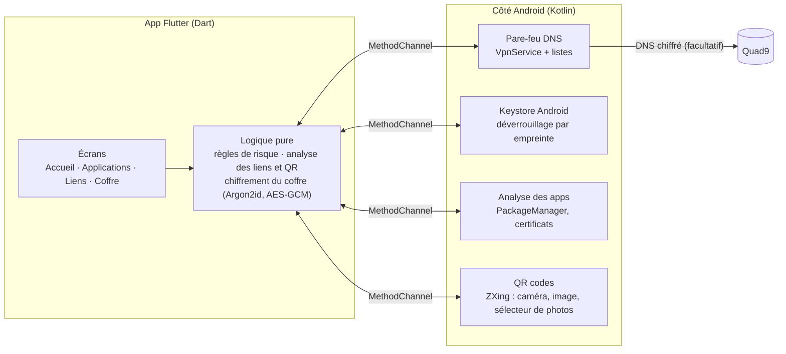

<p align="center">
  
</p>

<h1 align="center">Sentinel</h1>

<p align="center">
  <b>La sécurité de votre téléphone, vérifiée sur le téléphone lui-même : sans compte, sans serveur, sans pistage.</b>
</p>

<p align="center">
  <a href="https://github.com/Ihebnsir/sentinel/actions/workflows/ci.yml"></a>
  <a href="https://github.com/Ihebnsir/sentinel/releases/latest"></a>
  <a href="LICENSE"></a>
  
  
</p>

<p align="center">
  <a href="https://github.com/Ihebnsir/sentinel/releases/latest"></a>
</p>

<p align="center">
  <a href="README.md">English</a> · <b>Français</b>
</p>

---

Sentinel est une application Android de sécurité pensée pour les utilisateurs de tous les jours en Tunisie. Elle vérifie le téléphone, repère les applications risquées et les fausses applis, vérifie les liens et les QR codes avant que vous les ouvriez, bloque les sites dangereux avec un pare-feu DNS local et garde vos mots de passe dans un coffre chiffré. Interface en français, arabe (de droite à gauche) et anglais, thèmes clair et sombre.

## Captures d'écran

| Accueil | Applications | Vérificateur de liens | QR code (fausse appli) |
|:---:|:---:|:---:|:---:|
|  |  |  |  |

| Coffre | Pare-feu DNS | Accueil en arabe, thème sombre |
|:---:|:---:|:---:|
|  |  |  |

Données fictives uniquement. Écrans rendus par Flutter au format d'un Pixel 8 ([comment](docs/screenshots/README.md)) ; système de design dans [docs/DESIGN.md](docs/DESIGN.md).

## Fonctionnalités

- **Audit du téléphone.** Un score sur 100 (verrouillage de l'écran, root, mise à jour de sécurité, options pour les développeurs, débogage USB…), chaque problème relié au bon réglage d'Android.
- **Analyse des applications.** Un score de risque expliqué pour chaque app, les fausses applis (imitations de WhatsApp, mods de WhatsApp) et les logiciels espions connus, même déguisés en app système.
- **Vérificateur de liens.** Collez, partagez ou sélectionnez un lien : *Dangereux*, *Suspect* ou *Aucun problème connu*, où il mène vraiment (`site[.]xyz`) et pourquoi. Rien ne s'ouvre tout seul.
- **QR codes.** Scan à la caméra, choix d'une image ou image partagée vers Sentinel (QR reçu sur WhatsApp). Liens WhatsApp/Telegram, installations d'applis, fiches contact, adresses crypto… sont expliqués, et « Partager mon Wi-Fi » crée un QR code pour vos invités.
- **Pare-feu DNS.** Environ 582 000 domaines malveillants, d'hameçonnage et de pistage bloqués pour toutes les apps, avec une tuile dans les Paramètres rapides.
- **Coffre chiffré.** Mots de passe, notes, photos et PDF, déverrouillés par mot de passe maître, empreinte ou clé de récupération ; bilan des mots de passe ayant fuité, réutilisés ou faibles.

## Vie privée

1. Tout est analysé sur le téléphone : liens, QR codes, images et applications n'en sortent jamais.
2. Rien n'est envoyé sans action de votre part, sauf deux fonctions facultatives : la vérification des fuites de mots de passe (5 caractères d'une empreinte SHA-1, k-anonymat) et la mise à jour des listes de blocage (un simple téléchargement).
3. Quand vous activez le pare-feu DNS, les noms des sites autorisés sont résolus par Quad9, chiffrés (DNS sur TLS/HTTPS). Pas de compte, pas de statistiques, pas de publicité, pas de sauvegarde dans le cloud.

## Sécurité

- **Audit** selon **OWASP MASVS v2** (analyse statique et dynamique sur émulateur rooté) : **18 constats**, 15 corrigés avec chacun un test automatique, 3 acceptés avec justification. Rapport : [docs/audit/RAPPORT_AUDIT.md](docs/audit/RAPPORT_AUDIT.md).
- **Signature vérifiable.** Les APK officiels sont signés avec une seule clé de publication. Vérifiez avant d'installer :

  ```
  apksigner verify --print-certs sentinel-1.2.1.apk
  ```

  L'empreinte SHA-256 du certificat doit être `ec541b88160d995808bb24a61a8968d7c3c0311b02d955cc88b92fc7d08a1030`. Toute autre empreinte (par exemple `CN=Android Debug`) n'est pas une version officielle.
- **Modèle de menaces** et limites connues : [docs/SECURITY_DESIGN.md](docs/SECURITY_DESIGN.md) (en anglais). Signaler une faille en privé : [SECURITY.md](SECURITY.md).

## Architecture

Flutter (Dart) dessine l'interface et porte la logique de décision sous forme de fonctions pures, testées unitairement. Kotlin parle à Android par des `MethodChannel`.



Détails : [docs/ARCHITECTURE.md](docs/ARCHITECTURE.md) (en anglais).

## Décisions techniques

- **Un pare-feu DNS local plutôt qu'un serveur de filtrage.** Un `VpnService` qui ne transporte que les requêtes DNS filtre toutes les apps du téléphone sans voir votre trafic ni l'envoyer à Sentinel. La contrepartie (les apps qui chiffrent leur propre DNS y échappent) est documentée.
- **Argon2id + Keystore Android pour le coffre.** Le mot de passe maître passe par Argon2id (46 Mio) pour protéger une clé AES-256-GCM aléatoire ; le déverrouillage par empreinte utilise une clé du Keystore qui exige une biométrie forte et disparaît si une nouvelle empreinte est ajoutée.
- **k-anonymat pour les mots de passe ayant fuité.** Seuls les 5 premiers caractères hexadécimaux de l'empreinte SHA-1 partent vers Have I Been Pwned, avec une réponse rembourrée : le service ne peut pas connaître le mot de passe.
- **Retrait de l'analyse des messages (1.1.0).** Les versions 1.0.x classaient les SMS d'arnaque avec un modèle embarqué. Il n'avait pas de vraies données tunisiennes et demandait des accès que Play Protect bloque : il a été remplacé par un vérificateur de liens qui fonctionne sans aucune permission sensible.
- **Versions signées, obfusquées, et aucune permission bloquée par Play Protect.** Les builds de publication utilisent une clé dédiée et `--obfuscate` (symboles de débogage retirés) ; une tâche Gradle fait échouer le build si le manifeste fusionné gagne un lecteur de notifications, un service d'accessibilité, une permission SMS, ou toute permission hors de la liste attendue.

## Tests

814 tests Flutter et 190 tests Kotlin (JVM), lancés par la CI à chaque push, avec un seuil de couverture (≥ 85 % sur la logique) et Gitleaks.

```bash
flutter analyze
flutter test
(cd android && ./gradlew testDebugUnitTest)   # tests Kotlin + vérifications du manifeste
```

Prérequis : Flutter 3.47.7 (stable), Java 17, SDK Android. Publication : [docs/RELEASE.md](docs/RELEASE.md).

## Expériences (non utilisées par l'app)

- [`backend/`](backend/README.md) : un service FastAPI de signalements volontaires d'arnaques (anonymisés avant stockage, aucune adresse IP gardée), déployé sur Render + Neon avec dépendances épinglées, limitation de débit et son propre modèle de menaces ([docs/BACKEND_THREAT_MODEL.md](docs/BACKEND_THREAT_MODEL.md)).
- [`ml/`](ml/README.md) : la chaîne d'entraînement du modèle anti-arnaque des versions 1.0.x (TF-IDF + régression logistique, explicable, exécuté sur le téléphone).

Les deux restent dans le dépôt pour référence ; l'application actuelle n'appelle ni l'un ni l'autre.

## Développé avec l'aide de Claude Code

Sentinel a été développé avec l'aide de Claude Code (l'assistant de programmation d'Anthropic). J'ai conçu l'application, pris les décisions produit et sécurité, testé sur de vrais appareils, mené l'audit de sécurité et géré les publications ; Claude Code a aidé à écrire le code, les tests et la documentation sous cette direction.

## Données et licences tierces

Les QR codes sont décodés par [zxing-android-embedded](https://github.com/journeyapps/zxing-android-embedded) 4.3.0 et [ZXing](https://github.com/zxing/zxing) core 3.5.3 ([Apache 2.0](https://www.apache.org/licenses/LICENSE-2.0)). `assets/data/stalkerware_ioc.json` est dérivé de [Stalkerware Indicators of Compromise](https://github.com/AssoEchap/stalkerware-indicators) par [Echap](https://echap.eu.org/) ([CC BY 4.0](https://creativecommons.org/licenses/by/4.0/)) ; seuls les noms, paquets et empreintes de certificats sont gardés. Les listes du pare-feu DNS viennent de [Phishing.Database](https://github.com/Phishing-Database/Phishing.Database) (MIT), [BlockLists](https://github.com/ShadowWhisperer/BlockLists) (The Unlicense), [AdGuard CNAME trackers](https://github.com/AdguardTeam/cname-trackers) (MIT) et [AdAway](https://github.com/AdAway/adaway.github.io) (CC BY 3.0) : détails et textes des licences dans [tools/blocklists/README.md](tools/blocklists/README.md).

## Licence

[MIT](LICENSE) © 2026 Iheb
