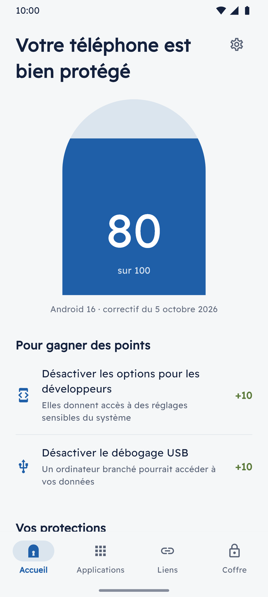
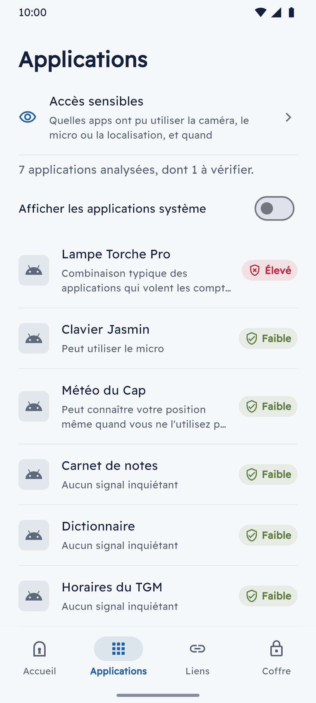
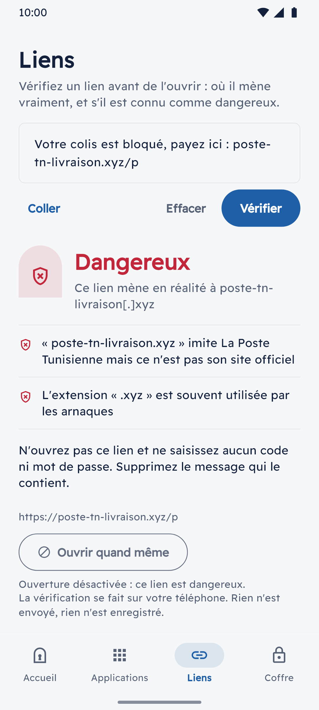
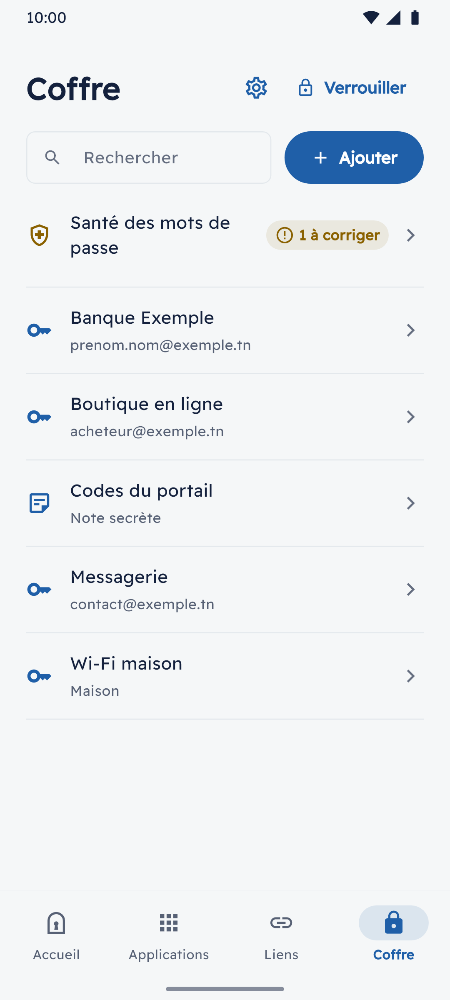

<p align="center">
  
</p>

<h1 align="center">Sentinel</h1>

<p align="center">
  Application de sécurité Android qui audite le téléphone, note les applications installées, vérifie les liens avant de les ouvrir, bloque les sites dangereux et protège les secrets dans un coffre chiffré.
</p>

<p align="center">
  <a href="https://github.com/Ihebnsir/sentinel/actions/workflows/ci.yml"></a>
  <a href="LICENSE"></a>
</p>

<p align="center">
  <a href="README.md">English</a> · <b>Français</b>
</p>

---

L'interface de l'application est en français, en arabe et en anglais. Tout se passe sur le téléphone. Rien ne passe par le réseau sans votre accord : les seuls appels réseau viennent de trois fonctions facultatives, la vérification des fuites auprès de Have I Been Pwned (5 caractères hexadécimaux d'une empreinte SHA-1, k-anonymity), le pare-feu DNS (transmet les requêtes DNS à Quad9, chiffrées en DNS-over-TLS ou HTTPS) et la mise à jour des listes de blocage (téléchargées depuis GitHub). Aucun message ni aucun lien n'est envoyé à un serveur.

## Installer : quelle version ?

**Installez `sentinel-<version>.apk` depuis la [page Releases](https://github.com/Ihebnsir/sentinel/releases).** Depuis la version 1.1.0, il n'existe qu'une seule variante Android (paquet `com.iheb.sentinel`).

Sentinel ne déclare ni lecteur de notifications, ni service d'accessibilité, ni permission SMS (une vérification Gradle fait échouer le build sinon) : la protection renforcée contre la fraude de Google Play Protect ne bloque plus l'APK. Les versions 1.0.0 et 1.0.1 avaient un onglet « Messages » (détection des messages d'arnaque sur le téléphone) ; il a été retiré en 1.1.0 et remplacé par le vérificateur de liens.

Si vous avez installé la 1.0.1 (`com.iheb.sentinel.standard`), c'est une appli distincte : exportez une sauvegarde du coffre si vous l'utilisiez, restaurez-la dans la 1.1.0, puis désinstallez la 1.0.1. Si vous avez encore la 1.0.0 (`com.iheb.sentinel`, même clé), la 1.1.0 s'installe par-dessus comme une mise à jour normale.

## Captures d'écran

> **TODO :** ajouter les captures dans `docs/screenshots/` (voir [docs/screenshots/README.md](docs/screenshots/README.md)), puis décommenter le tableau ci-dessous.

<!--
| Accueil | Applications | Messages | Coffre |
|:---:|:---:|:---:|:---:|
|  |  |  |  |
-->

## Fonctionnalités

- **Audit du téléphone.** Score de sécurité sur 100 calculé à partir de 7 vérifications : verrouillage d'écran, indices de root, âge du correctif de sécurité (< 90 jours), biométrie forte, options pour les développeurs, débogage USB et chiffrement du stockage. Les vérifications échouées ouvrent l'écran de réglages Android correspondant (sauf le root, qui ne se corrige pas depuis les réglages).
- **Analyse des applications.** Liste les applications installées et leur donne un score de risque de 0 à 100 avec des règles explicables : service d'accessibilité, source d'installation, administrateur de l'appareil, accès aux SMS, lecture des notifications, superposition, micro, localisation en arrière-plan, `targetSdk` ancien, etc. Les applications système préinstallées ne sont signalées que pour l'accessibilité ou l'administration de l'appareil.
- **Fausses applications et logiciels espions.** Lit le certificat de signature de chaque application (SHA-256/SHA-1, sujet) et vérifie si son icône a été cachée. Signale les applications qui prennent le nom d'une application connue (WhatsApp, Facebook, Instagram, TikTok…) avec un autre package, les packages officiels signés par quelqu'un d'autre (une fois les empreintes de référence remplies), les versions modifiées de WhatsApp (GB WhatsApp, FM WhatsApp…), les signatures de test et les stalkerwares connus de la liste publique [Stalkerware Indicators](https://github.com/AssoEchap/stalkerware-indicators), même déguisés en application système. En cas de logiciel espion possible, Sentinel affiche des conseils de sécurité **avant** de proposer la désinstallation, et n'envoie jamais de notification à ce sujet.
- **Vérificateur de liens (onglet « Liens »).** On colle un lien (ou un message qui en contient un), on touche « Coller », on partage un lien depuis une autre application, ou on sélectionne du texte puis « Vérifier le lien avec Sentinel » : Sentinel prend le premier lien (y compris dans un texte en arabe ou en derja) et affiche **Dangereux**, **Suspect** ou **Aucun problème connu**, « Ce lien mène en réalité à … » (le domaine enregistrable, neutralisé : `site[.]xyz`), les raisons et un conseil. Vérifications : usurpation de marque (banques tunisiennes, La Poste, opérateurs…), adresse IP, punycode, `@` dans l'URL, raccourcisseurs, extensions suspectes, trop de sous-domaines, `http` sans chiffrement, plus la liste « Malware et hameçonnage » du pare-feu et votre liste blanche (lues par Kotlin, même pare-feu arrêté). 100 % sur le téléphone, sans permission : rien n'est envoyé, rien n'est enregistré, un lien raccourci n'est jamais suivi pour découvrir sa destination. Rien ne s'ouvre tout seul, et « Ouvrir quand même » est désactivé pour un lien dangereux. Une ligne indique si le pare-feu protège vos clics partout (« Activer » en un appui).
- **Vérification des QR codes (quishing).** « Scanner un QR code », dans l'onglet Liens, lit le code sur le téléphone avec ZXing (sans réseau ni modèle téléchargé). La caméra n'est demandée qu'au moment du scan, après une explication. Sentinel affiche le contenu brut, puis vérifie le lien avec le vérificateur de liens. Les QR Wi-Fi montrent la protection (alerte si réseau ouvert) ; numéros, SMS et paiements (crypto, UPI, SEPA, EMVCo) affichent l'action exacte et demandent confirmation. Les liens `javascript:`/`intent:` et les codes USSD (`*`, `#`) sont bloqués. Rien ne s'ouvre tout seul, et « Ouvrir quand même » est désactivé pour un lien dangereux.
- **Analyse du Wi-Fi.** Affiche le type de chiffrement (ouvert, WEP, WPA2, WPA3, OWE, entreprise), la présence d'un portail captif et l'état du DNS privé, sans permission de localisation et sans lire le nom du réseau.
- **Tuile « Pare-feu Sentinel ».** Dans les Paramètres rapides d'Android (le panneau qu'on tire du haut de l'écran), une tuile avec l'arche montre si le pare-feu DNS est actif. Un appui l'active ou le coupe. Si l'écran est verrouillé, Android demande d'abord de le déverrouiller. Si l'autorisation VPN n'a jamais été donnée ou si le DNS privé est en mode strict, la tuile ouvre l'écran du pare-feu, qui explique quoi faire.
- **Coffre chiffré.** Range des mots de passe et des notes secrètes, chiffrés avec Argon2id + AES-256-GCM. On l'ouvre avec le mot de passe maître, une clé de récupération ou l'empreinte digitale (Android Keystore). Une sauvegarde chiffrée (fichier `.sentinel`) permet de le transférer sur un nouveau téléphone.
- **Thème sombre.** Une palette « nuit » assortie à l'icône (fond bleu nuit, textes clairs, couleurs d'état ajustées au contraste WCAG AA). Il suit le réglage du téléphone, ou se choisit (Clair / Sombre) dans les Réglages.
- **Outils mots de passe.** Générateur aléatoire (12 à 64 caractères), estimation de la force et bilan de santé des mots de passe : fuites (Have I Been Pwned), réutilisés et faibles.

## Points forts en sécurité

- **Respect de la vie privée dès la conception.** Pas de compte, pas de statistiques d'usage, pas de serveur : l'application n'envoie aucun message ni aucun lien. Les liens vérifiés restent en mémoire et ne sont jamais journalisés. (Les dossiers `backend/` et `ml/` restent dans le dépôt mais ne sont plus utilisés par l'application depuis la 1.1.0.)
- **Appels réseau sur accord uniquement.** Aucun appel réseau au démarrage (la police est embarquée). La vérification des fuites demande un consentement explicite. Elle utilise l'API « range » de Pwned Passwords (k-anonymity) : seuls les 5 premiers caractères hexadécimaux de l'empreinte SHA-1 quittent le téléphone, et l'en-tête `Add-Padding: true` masque la taille de la réponse. Les résultats restent en mémoire et sont effacés au verrouillage du coffre.
- **Cryptographie du coffre.** Une clé de données (DEK) aléatoire de 256 bits chiffre les éléments en AES-256-GCM, avec un nonce neuf de 12 octets à chaque écriture. La DEK est enveloppée par une clé de chiffrement de clé (KEK) pour chaque *emplacement de clé* (key slot) :
  - mot de passe : Argon2id, 46 Mio, 2 passes, parallélisme 1, sel aléatoire de 16 octets, calculé dans un isolate séparé ;
  - clé de récupération : 28 caractères parmi 32 symboles (140 bits), HKDF-SHA256 ;
  - empreinte : clé AES-256-GCM dans l'Android Keystore, `BIOMETRIC_STRONG` exigé à chaque opération, invalidée si une nouvelle empreinte est enregistrée.
- **En-tête authentifié.** Tout l'en-tête du fichier (emplacements, paramètres de dérivation, date de dernière ouverture par mot de passe) sert de données associées AES-GCM. Modifier un seul octet fait échouer le déchiffrement. Les paramètres de dérivation lus dans le fichier sont bornés : un fichier trafiqué ne peut pas exiger une mémoire ou un nombre de passes extrêmes.
- **Ouverture renforcée.** Délai croissant après un mauvais mot de passe (1 s, 2 s, 4 s… plafonné à 30 s). Le mot de passe maître est de nouveau exigé après 7 jours d'ouvertures par empreinte seule.
- **Protection à l'écran.** `FLAG_SECURE` sur l'onglet Coffre (pas de capture d'écran, aperçu masqué dans les applications récentes). Le coffre se verrouille quand l'écran s'éteint et après 30 s en arrière-plan. Les secrets copiés sont marqués sensibles (Android 13+) et effacés du presse-papiers après 30 s.
- **Alertes sûres.** Les alertes du pare-feu neutralisent les domaines (`site[.]xyz`) et désactivent les actions automatiques « Ouvrir le lien » d'Android. Le vérificateur de liens affiche lui aussi les domaines neutralisés.
- **Écriture atomique.** Le coffre est écrit dans un fichier temporaire puis renommé : un plantage ne peut pas l'abîmer.
- **Pas de sauvegarde Android.** `allowBackup="false"`, complété par des `dataExtractionRules` sur Android 12+, empêche les données de l'application de partir dans les sauvegardes cloud ou lors d'un transfert vers un autre téléphone. Pour changer de téléphone, on exporte le coffre à la place (point suivant).
- **Export / import chiffré.** « Exporter une sauvegarde chiffrée » (réglages du coffre) écrit un fichier `.sentinel` versionné : Argon2id d'un mot de passe d'export distinct (mêmes règles de force que le mot de passe maître) + AES-256-GCM, avec l'en-tête en données associées. Il est enregistré et ouvert via le sélecteur de fichiers d'Android (Storage Access Framework) : aucune permission de stockage. « Restaurer une sauvegarde » (écran de création du coffre) demande le fichier, son mot de passe, puis un nouveau mot de passe maître, et crée un coffre neuf avec une nouvelle clé de récupération. Mauvais mot de passe ou fichier modifié : message clair, jamais de plantage.

Modèle de menaces complet et limites connues : [docs/SECURITY_DESIGN.md](docs/SECURITY_DESIGN.md) (en anglais).

## Architecture

Flutter (Dart) gère l'interface et l'essentiel de la logique : calcul des scores, règles sur les liens, cryptographie. Kotlin accède aux API Android via des `MethodChannel` : état du téléphone, gestionnaire de paquets, Wi-Fi, Keystore et biométrie, pare-feu DNS (VpnService) et ses listes, qui répondent aussi au vérificateur de liens.

Schémas et détails : [docs/ARCHITECTURE.md](docs/ARCHITECTURE.md) (en anglais).

## Technologies

| Domaine | Technologie |
|---|---|
| Application | Flutter 3.47.7, Dart 3.13.5 |
| Android | Kotlin, Java 17, Android Gradle Plugin 9.1.0, Gradle 9.3.1 |
| Cryptographie | [`cryptography`](https://pub.dev/packages/cryptography) (Argon2id, AES-GCM, HKDF), [`crypto`](https://pub.dev/packages/crypto) (SHA-1), Android Keystore |
| Réseau | [`http`](https://pub.dev/packages/http) (API Pwned Passwords) |
| CI | GitHub Actions, Gitleaks, Dependabot |

## Tests

**696 tests** répartis dans 51 fichiers (`flutter test`), plus 172 tests Kotlin sur la JVM (`./gradlew testDebugUnitTest`). Ils couvrent :

- le coffre : vecteur de test Argon2id de la RFC 9106, chiffrement, emplacements de clé, migration v1 → v2, détection des modifications (chiffré, clé enveloppée, en-tête), session et verrouillage ;
- la sauvegarde chiffrée : aller-retour export/import, mauvais mot de passe, fichier altéré, version inconnue, fichier vide, restauration dans un coffre neuf ;
- le vérificateur de liens : extraction du premier lien (français, arabe, derja, plusieurs liens, aucun lien, caractères cachés), verdicts sur des arnaques connues, de vrais sites tunisiens et la liste blanche, l'onglet Liens en français et en arabe (de droite à gauche) ;
- la **parité** de la règle d'usurpation de marque entre Dart et Kotlin (`test/fixtures/brand_parity.json`) ;
- le client k-anonymity, avec un faux client HTTP ;
- les règles de risque des applications, du téléphone et du Wi-Fi ;
- le bilan de santé des mots de passe et le générateur ;
- les ponts vers Android (pare-feu, notifications, applications, biométrie, texte partagé) : arguments envoyés et chaque code d'erreur qu'Android peut renvoyer ;
- le manifeste Android fusionné : ni lecteur de notifications, ni service d'accessibilité, ni permission SMS (tâche Gradle `checkPlayProtect*`, lancée avant les tests Kotlin) ;
- les thèmes : contraste WCAG des principales paires de couleurs, et écrans principaux affichés en sombre ;
- l'accessibilité : zones tactiles de 48 dp, libellés TalkBack, contraste AA et police à 200 % sans débordement sur 19 écrans (voir [docs/ACCESSIBILITE.md](docs/ACCESSIBILITE.md)) ;
- les QR codes : lecture de chaque format (lien, `WIFI:`, `tel:`, `sms:`, paiements, texte), décisions de sécurité, et rien ne s'ouvre sans confirmation.

Le réseau et la biométrie sont remplacés par des doublures de test : les tests tournent hors ligne.

**Couverture.** La logique de l'app (`lib/services`, `lib/models`, `lib/utils`) est couverte à **95,6 %** des lignes (octobre 2026). Les écrans et widgets ne sont pas comptés. La CI lance `flutter test --coverage`, écrit un tableau par fichier dans le résumé de l'exécution et échoue sous 85 %. Aucun service tiers. En local :

```bash
flutter test --coverage
dart run tools/coverage/coverage_summary.dart --min=85
```

## Démarrage

Prérequis : Flutter 3.47.7 (stable), Java 17, SDK Android. Android est la seule plateforme cible.

```bash
git clone https://github.com/Ihebnsir/sentinel.git
cd sentinel
flutter pub get
flutter analyze
flutter test
flutter build apk --debug
(cd android && ./gradlew testDebugUnitTest)   # tests Kotlin + vérification du manifeste
```

Le build échoue si le manifeste fusionné déclare un accès bloqué par Play Protect. Les builds release sont signés avec la clé de publication : voir [docs/RELEASE.md](docs/RELEASE.md).

## Apprentissage automatique (non utilisé par l'application)

Jusqu'à la 1.0.1, un onglet « Messages » classait les messages d'arnaque avec un modèle embarqué entraîné dans `ml/`. Il a été retiré en 1.1.0 : le modèle n'avait pas de vraies données tunisiennes, et le copier-coller de messages n'était pas utilisé. Les dossiers `ml/` (entraînement) et `backend/` (serveur de signalement) restent dans le dépôt, sans être utilisés par l'application ; le modèle s'exporte désormais dans `ml/export/`. Voir [ml/README.md](ml/README.md).

## Feuille de route

Ces points viennent des limites connues relevées dans le code et la documentation. **TODO :** les relire et les classer.

- [ ] Vérifier à la main les domaines officiels de `lib/services/phishing/known_brands.dart` (TODO dans le code).
- [x] Signature release avec une clé de publication dédiée (SEN-01, voir « Vérifier un APK »).
- [ ] Conserver le compteur d'échecs d'ouverture après un redémarrage de l'application.
- [x] Export / import chiffré du coffre, pour le transférer sur un nouveau téléphone (la sauvegarde Android est volontairement désactivée).
- [ ] Ajouter les captures d'écran.
- [ ] Remplir les empreintes de certificat de référence dans `lib/services/apps/known_apps.dart` avec `tools/signatures/extract_cert.py`, ainsi que les packages des applications bancaires et postales tunisiennes (TODO dans le code).
- [ ] Ajouter des contacts d'aide tunisiens vérifiés à l'écran de conseils (TODO dans `spyware_advice_screen.dart`).

## Sécurité

Merci de signaler les vulnérabilités en privé. Voir [SECURITY.md](SECURITY.md).

L'application a été auditée selon l'OWASP MASVS v2 (analyse statique et dynamique, 17 constats et leurs corrections) : voir le [rapport d'audit](docs/audit/RAPPORT_AUDIT.md). La publication d'une version est décrite dans [docs/RELEASE.md](docs/RELEASE.md).

### Vérifier un APK

Les APK officiels de Sentinel sont signés avec une seule clé de publication. Avant d'installer un APK, vérifiez son certificat :

```
apksigner verify --print-certs sentinel-1.1.0.apk
```

La sortie doit indiquer `Verifies` et cette empreinte SHA-256 du certificat :

```
ec541b88160d995808bb24a61a8968d7c3c0311b02d955cc88b92fc7d08a1030
```

Toute autre empreinte (par exemple `CN=Android Debug`) signifie que l'APK n'est pas officiel : ne l'installez pas.

## Données tierces

Les QR codes sont décodés par [zxing-android-embedded](https://github.com/journeyapps/zxing-android-embedded) 4.3.0 et [ZXing](https://github.com/zxing/zxing) core 3.5.3, sous licence [Apache 2.0](https://www.apache.org/licenses/LICENSE-2.0).

`assets/data/stalkerware_ioc.json` est dérivé de [Stalkerware Indicators of Compromise](https://github.com/AssoEchap/stalkerware-indicators) par [Echap](https://echap.eu.org/) (Julien Voisin, Tek et contributeurs), sous licence [CC BY 4.0](https://creativecommons.org/licenses/by/4.0/deed.fr). Modifications : seuls les noms d'applications, les noms de packages et les empreintes SHA-1 des certificats sont conservés, convertis en JSON par `tools/stalkerware/update_ioc.py` à un commit épinglé. La liste n'est pas exhaustive : aucune correspondance ne veut pas dire aucun stalkerware.

Les listes du pare-feu DNS (`assets/blocklists/`) sont générées par `tools/blocklists/update_lists.py` à des commits épinglés, converties en liste de domaines, fusionnées et dédoublonnées (les domaines protégés sont retirés) :

- [Phishing.Database](https://github.com/Phishing-Database/Phishing.Database), sous licence [MIT](https://github.com/Phishing-Database/Phishing.Database/blob/master/LICENSE). Copyright (c) 2018-2025 Mitchell Krog, Copyright (c) 2018-2025 Nissar Chababy, Copyright (c) 2018-2025 Phishing.Database Contributors.
- [BlockLists](https://github.com/ShadowWhisperer/BlockLists) par ShadowWhisperer, dans le domaine public ([The Unlicense](https://github.com/ShadowWhisperer/BlockLists/blob/master/LICENSE)).
- [AdGuard CNAME disguised trackers list](https://github.com/AdguardTeam/cname-trackers), sous licence [MIT](https://github.com/AdguardTeam/cname-trackers/blob/master/LICENSE). Copyright 2021 Adguard Software Ltd.
- [AdAway default blocklist](https://github.com/AdAway/adaway.github.io) par Kicelo, Dominik Schuermann et contributeurs, sous licence [CC BY 3.0](https://creativecommons.org/licenses/by/3.0/deed.fr).

Détails, textes des licences MIT et sources écartées : [tools/blocklists/README.md](tools/blocklists/README.md).

## Licence

[MIT](LICENSE) © 2026 Iheb
