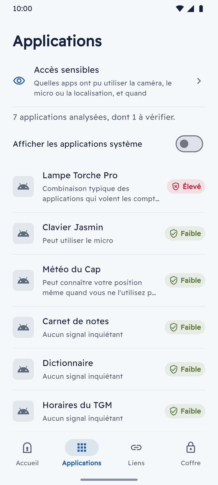
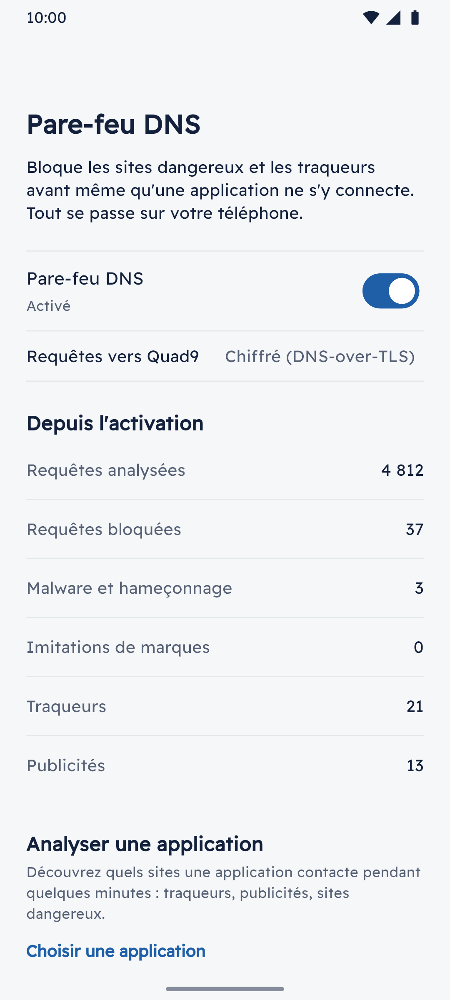
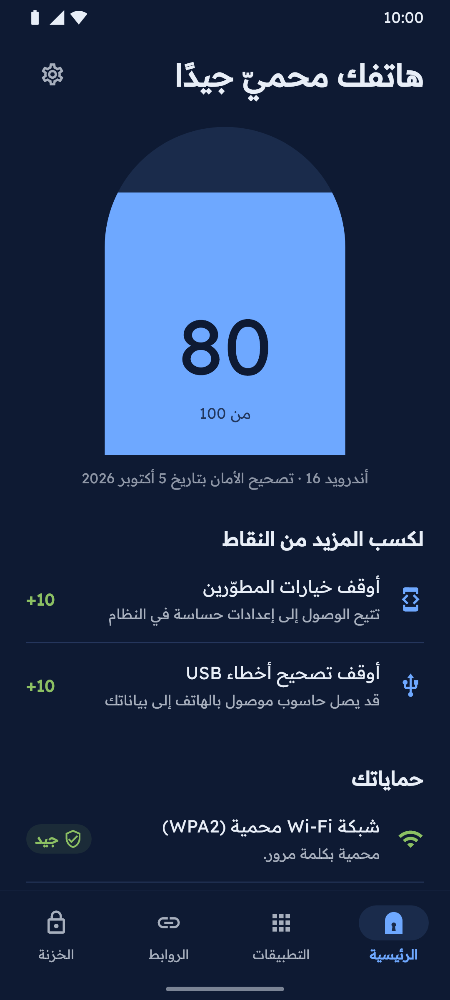
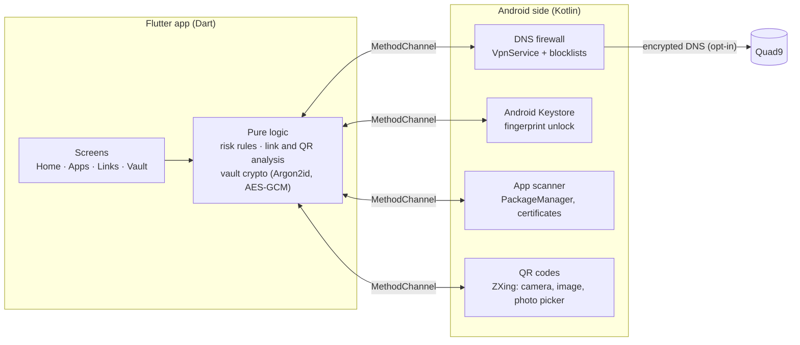

<p align="center">
  
</p>

<h1 align="center">Sentinel</h1>

<p align="center">
  <b>Your phone's security, checked on the phone itself: no account, no server, no tracking.</b>
</p>

<p align="center">
  <a href="https://github.com/Ihebnsir/sentinel/actions/workflows/ci.yml"></a>
  <a href="https://github.com/Ihebnsir/sentinel/releases/latest"></a>
  <a href="LICENSE"></a>
  
  
</p>

<p align="center">
  <a href="https://github.com/Ihebnsir/sentinel/releases/latest"></a>
</p>

<p align="center">
  <b>English</b> · <a href="README.fr.md">Français</a>
</p>

---

Sentinel is an Android security app built for everyday users in Tunisia. It audits the phone, spots risky and fake apps, checks links and QR codes before you open them, blocks dangerous sites with a local DNS firewall, and keeps passwords in an encrypted vault. Interface in French, Arabic (right to left) and English, light and dark themes.

## Screenshots

| Home | Apps | Link checker | QR code (fake app) |
|:---:|:---:|:---:|:---:|
|  |  |  |  |

| Vault | DNS firewall | Home in Arabic, dark theme |
|:---:|:---:|:---:|
|  |  |  |

Fictitious data only. Rendered by Flutter at Pixel 8 size ([how](docs/screenshots/README.md)); design system in [docs/DESIGN.md](docs/DESIGN.md).

## Features

- **Phone audit.** A score out of 100 (screen lock, root, security patch, developer options, USB debugging…), each problem linked to the right Android setting.
- **App scanner.** An explained risk score for every app, fake apps (WhatsApp look-alikes, WhatsApp mods) and known stalkerware, even disguised as a system app.
- **Link checker.** Paste, share or select a link: *Dangerous*, *Suspicious* or *No known problem*, where it really leads (`site[.]xyz`) and why. Nothing opens by itself.
- **QR codes.** Scan with the camera, pick an image or share one to Sentinel (a QR code received on WhatsApp). WhatsApp/Telegram links, app installs, contact cards, crypto addresses… are explained, and "Share my Wi-Fi" makes a QR code for your guests.
- **DNS firewall.** About 582,000 malware, phishing and tracker domains blocked for every app, with a Quick Settings tile.
- **Encrypted vault.** Passwords, notes, photos and PDFs, unlocked by master password, fingerprint or recovery key; breached, reused and weak password report.

## Privacy

1. Everything is analysed on the phone: links, QR codes, images and apps never leave it.
2. Nothing is sent without your action, except two opt-in features: the password breach check (only 5 characters of a SHA-1 hash, k-anonymity) and the blocklist updates (a plain download).
3. When you turn on the DNS firewall, the names of allowed sites are resolved by Quad9, encrypted (DNS over TLS/HTTPS). No account, no analytics, no ads, no cloud backup.

## Security

- **Audited** against **OWASP MASVS v2** (static and dynamic analysis on a rooted emulator): **18 findings**, 15 fixed with an automated test each, 3 accepted with a reason. Report: [docs/audit/RAPPORT_AUDIT.md](docs/audit/RAPPORT_AUDIT.md) (in French).
- **Verifiable signature.** Official APKs are signed with a single release key. Check before installing:

  ```
  apksigner verify --print-certs sentinel-1.2.1.apk
  ```

  The certificate SHA-256 digest must be `ec541b88160d995808bb24a61a8968d7c3c0311b02d955cc88b92fc7d08a1030`. Anything else (for example `CN=Android Debug`) is not an official build.
- **Threat model** and known limitations: [docs/SECURITY_DESIGN.md](docs/SECURITY_DESIGN.md). Report a vulnerability privately: [SECURITY.md](SECURITY.md).

## Architecture

Flutter (Dart) draws the interface and holds the decision logic as pure, unit-tested functions. Kotlin talks to Android through `MethodChannel`s.



Details: [docs/ARCHITECTURE.md](docs/ARCHITECTURE.md).

## Technical decisions

- **A local DNS firewall instead of a filtering server.** A `VpnService` that only carries DNS queries filters every app on the device without seeing your traffic or sending it to Sentinel. The trade-off (apps with their own encrypted DNS escape it) is documented.
- **Argon2id + Android Keystore for the vault.** The master password goes through Argon2id (46 MiB) to wrap a random AES-256-GCM key; fingerprint unlock uses a Keystore key that requires strong biometrics and dies when a new fingerprint is enrolled.
- **k-anonymity for breached passwords.** Only the first 5 hex characters of the SHA-1 hash are sent to Have I Been Pwned, with response padding: the service cannot learn the password.
- **Removing message analysis (1.1.0).** Versions 1.0.x classified scam SMS with an on-device model. It was trained without real Tunisian data and needed permissions that Play Protect blocks, so it was replaced by a link checker that works without any sensitive permission.
- **Signed, obfuscated releases, and no permission Play Protect blocks.** Release builds use a dedicated key and `--obfuscate` with debug symbols stripped; a Gradle task fails the build if the merged manifest gains a notification listener, an accessibility service, an SMS permission, or any permission outside the expected list.

## Tests

814 Flutter tests and 190 Kotlin JVM tests, run by the CI on every push, plus a coverage gate (≥ 85 % on the app logic) and Gitleaks.

```bash
flutter analyze
flutter test
(cd android && ./gradlew testDebugUnitTest)   # Kotlin tests + manifest checks
```

Prerequisites: Flutter 3.47.7 (stable), Java 17, Android SDK. Release builds: [docs/RELEASE.md](docs/RELEASE.md) (in French).

## Experiments (not used by the app)

- [`backend/`](backend/README.md): a FastAPI service for voluntary scam reports (anonymised before storage, no IP kept), deployed on Render + Neon with pinned dependencies, rate limiting and its own threat model ([docs/BACKEND_THREAT_MODEL.md](docs/BACKEND_THREAT_MODEL.md)).
- [`ml/`](ml/README.md): the training pipeline of the 1.0.x scam-message model (TF-IDF + logistic regression, explainable, run on the phone).

Both stay in the repository for reference; the current app calls neither.

## Built with Claude Code

Sentinel was developed with the help of Claude Code (Anthropic's coding assistant). I designed the app, made the product and security decisions, tested it on real devices, ran the security audit and handled the releases; Claude Code helped write code, tests and documentation under that direction.

## Third-party data and licenses

QR codes are decoded by [zxing-android-embedded](https://github.com/journeyapps/zxing-android-embedded) 4.3.0 and [ZXing](https://github.com/zxing/zxing) core 3.5.3 ([Apache 2.0](https://www.apache.org/licenses/LICENSE-2.0)). `assets/data/stalkerware_ioc.json` is derived from [Stalkerware Indicators of Compromise](https://github.com/AssoEchap/stalkerware-indicators) by [Echap](https://echap.eu.org/) ([CC BY 4.0](https://creativecommons.org/licenses/by/4.0/)); only names, packages and certificate fingerprints are kept. The DNS firewall lists come from [Phishing.Database](https://github.com/Phishing-Database/Phishing.Database) (MIT), [BlockLists](https://github.com/ShadowWhisperer/BlockLists) (The Unlicense), [AdGuard CNAME trackers](https://github.com/AdguardTeam/cname-trackers) (MIT) and [AdAway](https://github.com/AdAway/adaway.github.io) (CC BY 3.0): details and license texts in [tools/blocklists/README.md](tools/blocklists/README.md).

## License

[MIT](LICENSE) © 2026 Iheb
