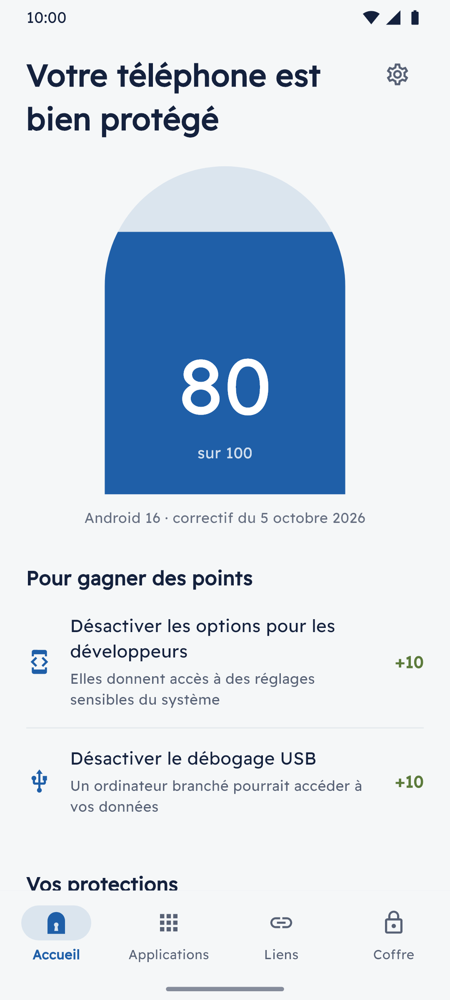
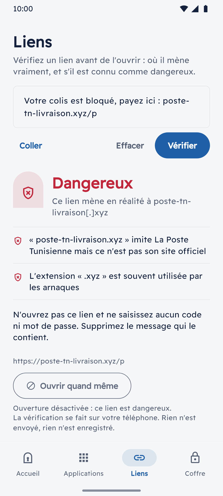
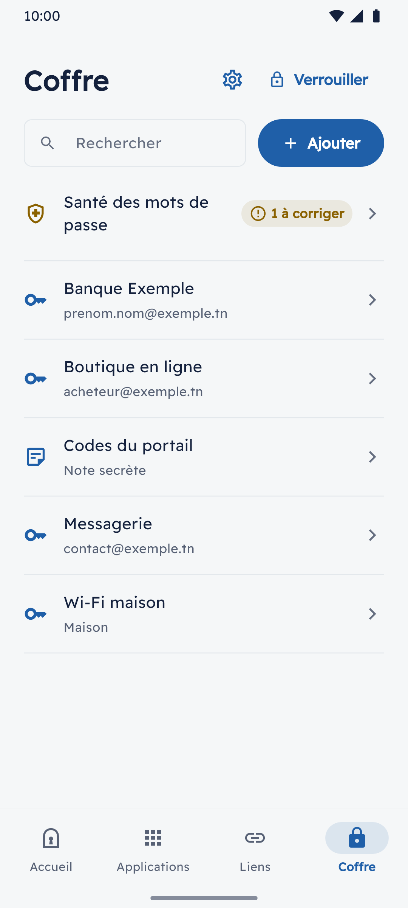

<p align="center">
  
</p>

<h1 align="center">Sentinel</h1>

<p align="center">
  Android security app that audits the phone, scores installed apps, checks links before you open them, blocks dangerous sites and keeps secrets in an encrypted vault.
</p>

<p align="center">
  <a href="https://github.com/Ihebnsir/sentinel/actions/workflows/ci.yml"></a>
  <a href="LICENSE"></a>
</p>

<p align="center">
  <b>English</b> · <a href="README.fr.md">Français</a>
</p>

---

The app's interface is in French, Arabic and English. Everything runs on the phone. Nothing goes over the network without your consent: the only network calls are three opt-in features, the breach check against Have I Been Pwned (5 hex characters of a SHA-1 hash, k-anonymity), the DNS firewall (forwards DNS queries to Quad9, encrypted with DNS over TLS or HTTPS) and the blocklist updates (downloads from GitHub). No message and no link is ever sent to a server.

## Install: which version?

**Install `sentinel-<version>.apk` from the [Releases page](https://github.com/Ihebnsir/sentinel/releases).** Since version 1.1.0 there is a single Android variant (package `com.iheb.sentinel`).

Sentinel declares no notification listener, no accessibility service and no SMS permission (a Gradle check fails the build otherwise), so Google Play Protect's enhanced fraud protection no longer blocks the APK. Versions 1.0.0 and 1.0.1 had a "Messages" tab (on-device scam message detection); it was removed in 1.1.0 and replaced by the link checker.

If you installed 1.0.1 (`com.iheb.sentinel.standard`), it is a separate app: export a vault backup if you used the vault, restore it in 1.1.0, then uninstall 1.0.1. If you still have 1.0.0 (`com.iheb.sentinel`, same key), 1.1.0 installs over it as a normal update.

## Screenshots

> **TODO:** add screenshots to `docs/screenshots/` (see [docs/screenshots/README.md](docs/screenshots/README.md)), then uncomment the table below.

<!--
| Home | Apps | Links | Vault |
|:---:|:---:|:---:|:---:|
|  |  |  |  |
-->

## Features

- **Device audit.** Security score out of 100 from 7 checks: screen lock, root indicators, security patch age (< 90 days), strong biometrics, developer options, USB debugging and storage encryption. Failed checks link to the matching Android settings screen (except root, which can't be fixed from settings).
- **App scanner.** Lists installed apps and gives each a 0–100 risk score from explainable rules: accessibility service, install source, device admin, SMS access, notification listener, overlay, microphone, background location, old `targetSdk`, and more. Pre-installed system apps are only flagged for accessibility or device admin.
- **Fake apps and stalkerware.** Reads each app's signing certificate (SHA-256/SHA-1, subject) and whether its launcher icon was hidden. Flags apps that use the name of a popular app (WhatsApp, Facebook, Instagram, TikTok…) with another package, official packages signed by someone else (once reference fingerprints are filled in), known WhatsApp mods (GB WhatsApp, FM WhatsApp…), test-key signatures, and known stalkerware from the public [Stalkerware Indicators](https://github.com/AssoEchap/stalkerware-indicators) list, even when disguised as a system app. When spyware is suspected, Sentinel shows safety advice **before** offering to uninstall, and never sends a notification about it.
- **Link checker ("Links" tab).** Paste a link (or a message containing one), tap "Paste", share a link from another app, or select text and choose "Check link with Sentinel": Sentinel takes the first link (also in Arabic or Derja text) and shows **Dangerous**, **Suspicious** or **No known problem**, "This link really leads to …" (the registrable domain, defanged: `site[.]xyz`), the reasons and advice. Checks: brand impersonation (Tunisian banks, La Poste, operators…), raw IP address, punycode, `@` in the URL, URL shorteners, suspicious TLDs, too many subdomains, plain `http`, plus the firewall's malware/phishing list and your allowlist (read by Kotlin, even when the firewall is off). 100 % on the phone, no permission: nothing is sent, nothing is saved, a shortened link is never followed to find its target. Nothing opens automatically, and "Open anyway" is disabled for a dangerous link. A row shows whether the firewall protects your taps everywhere ("Turn on" in one tap).
- **QR code check (quishing).** "Scan a QR code" in the Links tab reads the code on the phone with ZXing (no network, no downloaded model). The camera is requested only at scan time, after an explanation. Sentinel shows the raw content, then checks the link with the link checker. Wi-Fi codes show the encryption (open network alert); phone numbers, text messages and payment codes (crypto, UPI, SEPA, EMVCo) show the exact action and ask for confirmation. `javascript:`/`intent:` links and USSD codes (`*`, `#`) are blocked. Nothing opens automatically, and "Open anyway" is disabled for a dangerous link.
- **Wi-Fi check.** Shows the encryption type (open, WEP, WPA2, WPA3, OWE, enterprise), captive portal and Private DNS status, without the location permission and without reading the network name.
- **"Pare-feu Sentinel" Quick Settings tile.** In Android's Quick Settings (the panel pulled down from the top of the screen), a tile with the arch shows whether the DNS firewall is on. A tap turns it on or off. If the screen is locked, Android asks to unlock first. If the VPN permission was never granted or Private DNS is in strict mode, the tile opens the firewall screen, which explains what to do.
- **Encrypted vault.** Stores passwords and secure notes, encrypted with Argon2id + AES-256-GCM. You can unlock it with the master password, a recovery key, or a fingerprint (Android Keystore). An encrypted backup file (`.sentinel`) moves it to a new phone.
- **Dark theme.** A "night" palette matching the app icon (navy background, light text, status colors adjusted to WCAG AA contrast). It follows the phone setting, or Light / Dark can be chosen in Settings.
- **Password tools.** Random password generator (12–64 characters), strength estimate, and a password health report: breached (Have I Been Pwned), reused and weak passwords.

## Security highlights

- **Privacy by design.** No account, no analytics, no server: the app sends no message and no link anywhere. Checked links are kept in memory only and never logged. (The `backend/` and `ml/` folders are kept in the repository but are not used by the app since 1.1.0.)
- **Opt-in network calls only.** No network call at startup (the font is bundled). The breach check needs explicit consent. It uses the Pwned Passwords range API (k-anonymity): only the first 5 hex characters of the SHA-1 hash leave the device, and `Add-Padding: true` hides the response size. Results stay in memory and are cleared when the vault locks.
- **Vault cryptography.** A random 256-bit data key (DEK) encrypts the items with AES-256-GCM, using a fresh 12-byte nonce on every write. The DEK is wrapped by one key-encryption key (KEK) per *key slot*:
  - password: Argon2id, 46 MiB, 2 iterations, parallelism 1, 16-byte random salt, run in a separate isolate;
  - recovery key: 28 characters from a 32-symbol alphabet (140 bits), HKDF-SHA256;
  - fingerprint: AES-256-GCM key in the Android Keystore, `BIOMETRIC_STRONG` required for every operation, invalidated when a new fingerprint is enrolled.
- **Authenticated header.** The whole file header (slots, KDF parameters, last password unlock date) is the AES-GCM associated data. Changing a single byte makes decryption fail. KDF parameters read from the file have bounds, so a tampered file cannot request extreme memory or iterations.
- **Unlock hardening.** Growing delay after a wrong password (1 s, 2 s, 4 s… capped at 30 s). The master password is required again after 7 days of fingerprint-only unlocks.
- **On-screen protection.** `FLAG_SECURE` on the vault tab (no screenshots, hidden in recent apps). The vault locks when the screen turns off and after 30 s in the background. Copied secrets are marked sensitive (Android 13+) and cleared from the clipboard after 30 s.
- **Safe alerts.** Firewall alerts defang domains (`site[.]xyz`) and disable Android's automatic "open link" actions. The link checker shows domains defanged too.
- **Atomic writes.** The vault is written to a temporary file and then renamed, so a crash cannot corrupt it.
- **No Android backup.** `allowBackup="false"`, plus `dataExtractionRules` on Android 12+, keep app data out of cloud backups and device-to-device transfers. To change phones, the user exports the vault instead (next point).
- **Encrypted export / import.** "Exporter une sauvegarde chiffrée" (vault settings) writes a versioned `.sentinel` file: Argon2id of a separate export password (same strength rules as the master password) + AES-256-GCM, with the header as associated data. It is saved and opened through the Android file picker (Storage Access Framework), so the app needs no storage permission. "Restaurer une sauvegarde" (vault creation screen) asks for the file, its password, then a new master password, and creates a new vault with a new recovery key. A wrong password or a modified file gets a clear message, never a crash.

Full threat model and known limitations: [docs/SECURITY_DESIGN.md](docs/SECURITY_DESIGN.md).

## Architecture

Flutter (Dart) handles the UI and most of the logic: scoring, link rules, cryptography. Kotlin talks to Android APIs through `MethodChannel`s: device state, package manager, Wi-Fi, Keystore and biometrics, the DNS firewall (VpnService) and its blocklists, which also answer the link checker.

Diagrams and details: [docs/ARCHITECTURE.md](docs/ARCHITECTURE.md).

## Tech stack

| Area | Technology |
|---|---|
| App | Flutter 3.47.7, Dart 3.13.5 |
| Android | Kotlin, Java 17, Android Gradle Plugin 9.1.0, Gradle 9.3.1 |
| Cryptography | [`cryptography`](https://pub.dev/packages/cryptography) (Argon2id, AES-GCM, HKDF), [`crypto`](https://pub.dev/packages/crypto) (SHA-1), Android Keystore |
| Network | [`http`](https://pub.dev/packages/http) (Pwned Passwords API) |
| CI | GitHub Actions, Gitleaks, Dependabot |

## Tests

**696 tests** in 51 test files (`flutter test`), plus 172 Kotlin JVM tests (`./gradlew testDebugUnitTest`). They cover:

- the vault: the Argon2id RFC 9106 test vector, encryption, key slots, v1 → v2 migration, tamper detection (ciphertext, wrapped key, header), session and lock behavior;
- the encrypted backup: export/import round trip, wrong password, tampered file, unknown version, empty file, restore into a new vault;
- the link checker: first-link extraction (French, Arabic, Derja, several links, no link, hidden characters), verdicts on known scams, real Tunisian sites and the allowlist, the Links tab in French and Arabic (right to left);
- **parity** of the brand impersonation rule between Dart and Kotlin (`test/fixtures/brand_parity.json`);
- the k-anonymity client, using a fake HTTP client;
- the app, device and Wi-Fi risk rules;
- password health and the password generator;
- the Android bridges (firewall, notifications, apps, biometrics, shared text): arguments sent, and every error code Android can return;
- the merged Android manifest: no notification listener, accessibility service or SMS permission (Gradle task `checkPlayProtect*`, run before the Kotlin tests);
- the themes: WCAG contrast of the main color pairs, and the main screens rendered in dark mode;
- accessibility: 48 dp tap targets, TalkBack labels, AA contrast and 200 % font size without overflow on 19 screens (see [docs/ACCESSIBILITE.md](docs/ACCESSIBILITE.md), in French);
- QR codes: parsing of every supported format (link, `WIFI:`, `tel:`, `sms:`, payments, text), the security decisions, and that nothing opens without confirmation.

Network and biometrics are replaced by test doubles, so the tests run offline.

**Coverage.** The app logic (`lib/services`, `lib/models`, `lib/utils`) is at **95.6 %** line coverage (October 2026). Screens and widgets are not counted. The CI runs `flutter test --coverage`, writes a per-file table in the run summary and fails below 85 %. No third-party service. Locally:

```bash
flutter test --coverage
dart run tools/coverage/coverage_summary.dart --min=85
```

## Getting started

Prerequisites: Flutter 3.47.7 (stable), Java 17, Android SDK. Android is the only target platform.

```bash
git clone https://github.com/Ihebnsir/sentinel.git
cd sentinel
flutter pub get
flutter analyze
flutter test
flutter build apk --debug
(cd android && ./gradlew testDebugUnitTest)   # Kotlin tests + manifest check
```

The build fails if the merged manifest declares an access blocked by Play Protect. Release builds are signed with the release key: see [docs/RELEASE.md](docs/RELEASE.md) (in French).

## Machine learning (not used by the app)

Until 1.0.1, a "Messages" tab classified scam messages with an on-device model trained in `ml/`. It was removed in 1.1.0: the model had no real Tunisian data, and copy-pasting messages was not used. The `ml/` (training) and `backend/` (report server) folders stay in the repository, unused by the app; the model now exports to `ml/export/`. See [ml/README.md](ml/README.md).

## Roadmap

These items come from the known limitations in the code and docs. **TODO:** review and reorder them.

- [ ] Manually verify the official domains in `lib/services/phishing/known_brands.dart` (TODO in the code).
- [x] Release signing with a dedicated release key (SEN-01, see "Verify an APK").
- [ ] Persist the failed-unlock counter across app restarts.
- [x] Encrypted vault export/import, to move the vault to a new phone (Android backup is disabled on purpose).
- [ ] Add screenshots.
- [ ] Fill in the reference certificate fingerprints in `lib/services/apps/known_apps.dart` with `tools/signatures/extract_cert.py`, and the packages of Tunisian banking and postal apps (TODO in the code).
- [ ] Add verified Tunisian help contacts to the stalkerware advice screen (TODO in `spyware_advice_screen.dart`).

## Security

Please report vulnerabilities privately. See [SECURITY.md](SECURITY.md).

The app was audited against OWASP MASVS v2 (static and dynamic analysis, 17 findings and their fixes): see the [audit report](docs/audit/RAPPORT_AUDIT.md) (in French). Release builds are documented in [docs/RELEASE.md](docs/RELEASE.md).

### Verify an APK

Official Sentinel APKs are signed with a single release key. Before installing an APK, check its certificate:

```
apksigner verify --print-certs sentinel-1.1.0.apk
```

The output must say `Verifies` and show this certificate SHA-256 digest:

```
ec541b88160d995808bb24a61a8968d7c3c0311b02d955cc88b92fc7d08a1030
```

Any other fingerprint (for example `CN=Android Debug`) means the APK is not an official build: do not install it.

## Third-party data

QR codes are decoded by [zxing-android-embedded](https://github.com/journeyapps/zxing-android-embedded) 4.3.0 and [ZXing](https://github.com/zxing/zxing) core 3.5.3, licensed under [Apache 2.0](https://www.apache.org/licenses/LICENSE-2.0).

`assets/data/stalkerware_ioc.json` is derived from [Stalkerware Indicators of Compromise](https://github.com/AssoEchap/stalkerware-indicators) by [Echap](https://echap.eu.org/) (Julien Voisin, Tek and contributors), licensed under [CC BY 4.0](https://creativecommons.org/licenses/by/4.0/). Changes: only app names, package names and SHA-1 certificate fingerprints are kept, converted to JSON by `tools/stalkerware/update_ioc.py` at a pinned commit. The list is not exhaustive: no match does not mean no stalkerware.

The DNS firewall lists (`assets/blocklists/`) are generated by `tools/blocklists/update_lists.py` at pinned commits, converted to domain lists, merged and deduplicated (protected domains are removed):

- [Phishing.Database](https://github.com/Phishing-Database/Phishing.Database), licensed under [MIT](https://github.com/Phishing-Database/Phishing.Database/blob/master/LICENSE). Copyright (c) 2018-2025 Mitchell Krog, Copyright (c) 2018-2025 Nissar Chababy, Copyright (c) 2018-2025 Phishing.Database Contributors.
- [BlockLists](https://github.com/ShadowWhisperer/BlockLists) by ShadowWhisperer, public domain ([The Unlicense](https://github.com/ShadowWhisperer/BlockLists/blob/master/LICENSE)).
- [AdGuard CNAME disguised trackers list](https://github.com/AdguardTeam/cname-trackers), licensed under [MIT](https://github.com/AdguardTeam/cname-trackers/blob/master/LICENSE). Copyright 2021 Adguard Software Ltd.
- [AdAway default blocklist](https://github.com/AdAway/adaway.github.io) by Kicelo, Dominik Schuermann and contributors, licensed under [CC BY 3.0](https://creativecommons.org/licenses/by/3.0/).

Details, MIT license texts and rejected sources: [tools/blocklists/README.md](tools/blocklists/README.md).

## License

[MIT](LICENSE) © 2026 Iheb
