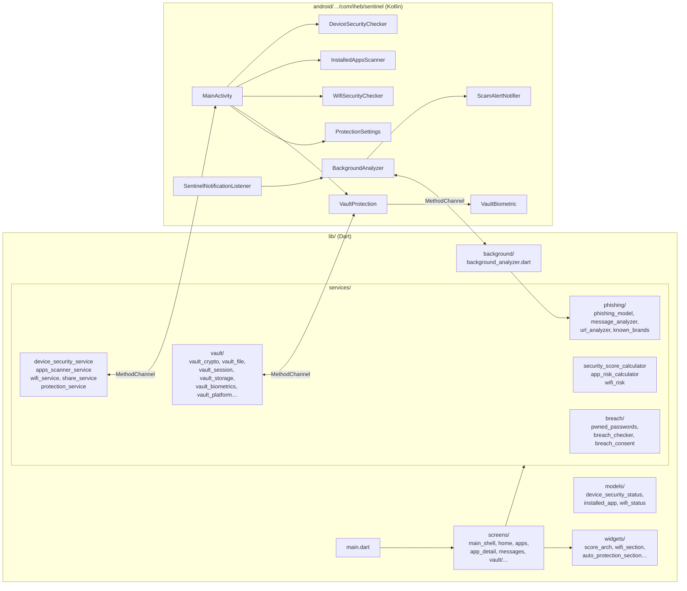
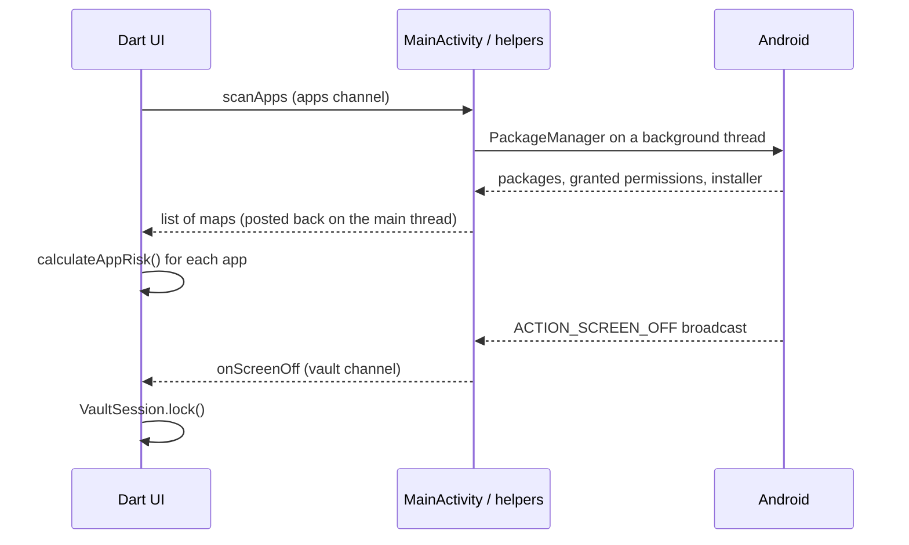
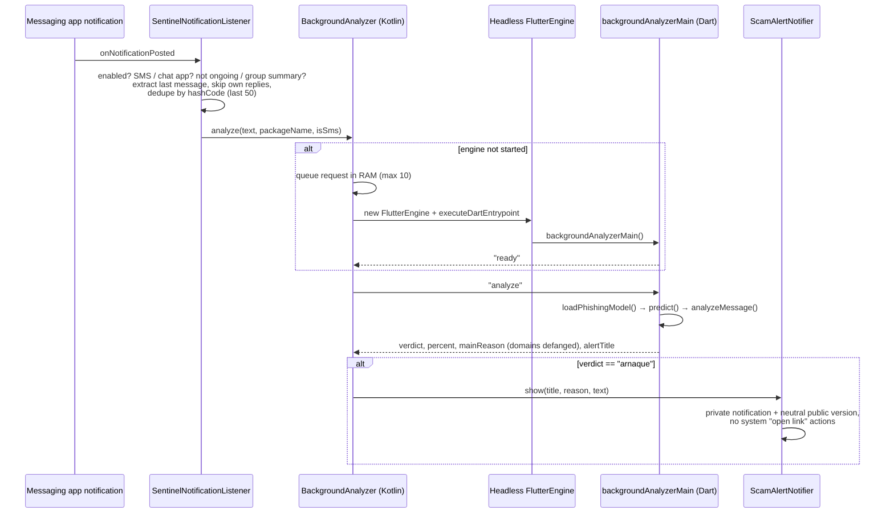
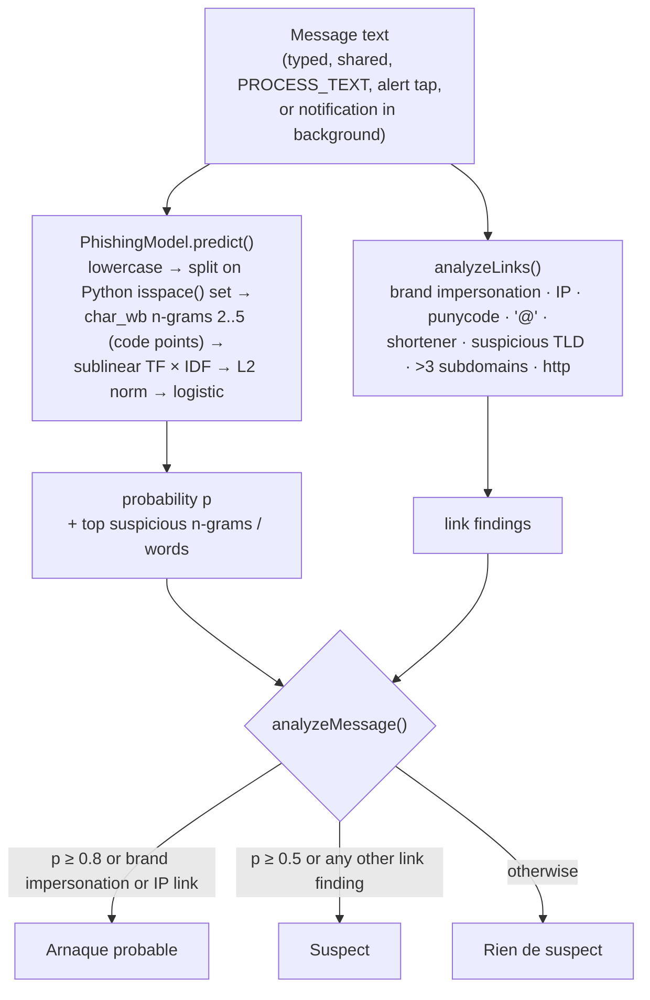
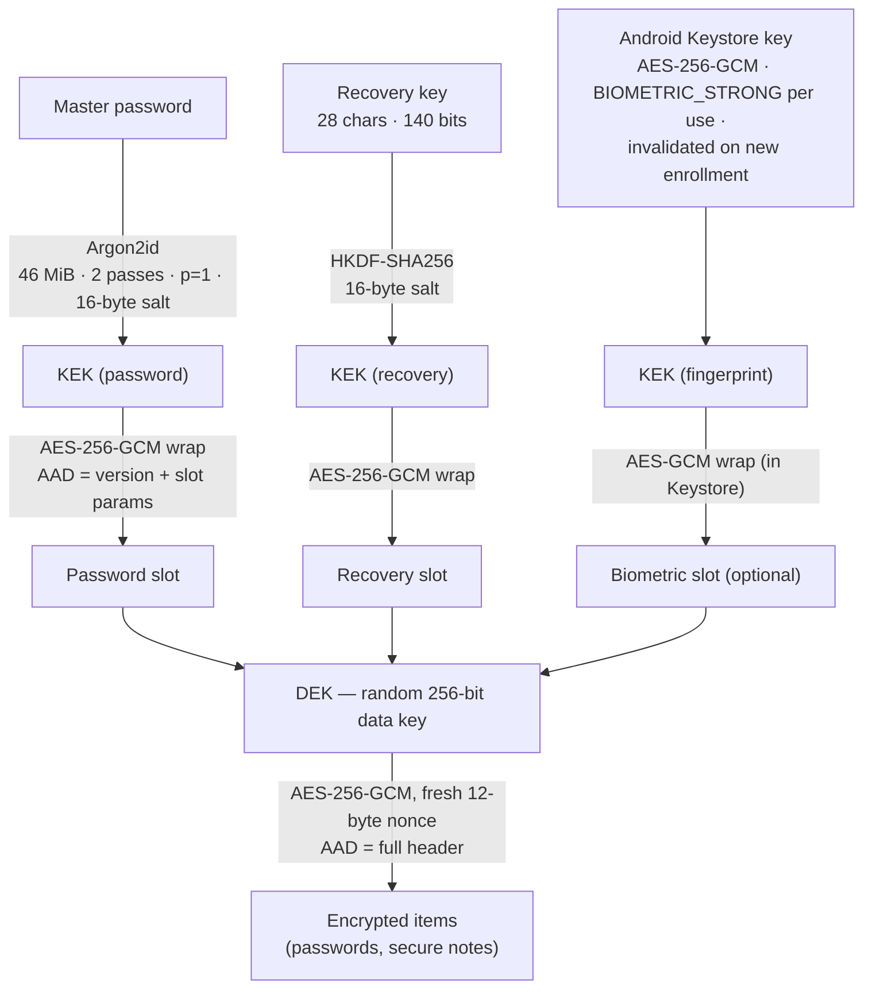

# Architecture

[← Back to README](../README.md) · [Security design](SECURITY_DESIGN.md)

Sentinel is a Flutter app with Android as its only target. Dart contains the UI and all the decision logic (risk rules, ML inference, cryptography). Kotlin reads Android state and talks to the system services that Flutter cannot reach directly. The two sides communicate through named `MethodChannel`s.

Most of the logic is written as **pure functions** (`calculateSecurityScore`, `calculateAppRisk`, `assessWifi`, `analyzeMessage`, `analyzePasswordHealth`…). They take plain data and return a report without calling Android, which makes them easy to unit-test.

## Code layout



The app has four tabs (`main_shell.dart`): **Accueil** (device audit and Wi-Fi), **Applications**, **Messages** (message check and the automatic protection switch) and **Coffre** (vault).

## Method channels

| Channel | Kotlin side | Dart → Kotlin | Kotlin → Dart |
|---|---|---|---|
| `com.iheb.sentinel/device_security` | `MainActivity` → `DeviceSecurityChecker` | `getSecurityStatus`, `openSettings` | — |
| `com.iheb.sentinel/apps` | `MainActivity` → `InstalledAppsScanner` (background executor) | `scanApps`, `openAppSettings`, `uninstallApp` | — |
| `com.iheb.sentinel/share` | `MainActivity` | `getInitialSharedText` | `onSharedText` |
| `com.iheb.sentinel/protection` | `MainActivity` → `ProtectionSettings` | `getStatus`, `setEnabled`, `openListenerSettings`, `openNotificationSettings`, `requestNotificationPermission` | — |
| `com.iheb.sentinel/wifi` | `WifiSecurityChecker` | `getWifiStatus`, `startListening`, `stopListening`, `openPrivateDnsSettings` | `onWifiChanged` (debounced 400 ms) |
| `com.iheb.sentinel/vault` | `VaultProtection` → `VaultBiometric` | `setSecure`, `copySensitive`, `clearClipboard`, `biometricAvailable`, `biometricEncrypt`, `biometricDecrypt`, `biometricDeleteKey` | `onScreenOff` |
| `com.iheb.sentinel/background_analysis` | `BackgroundAnalyzer` (headless engine) | `ready` | `analyze` |



## Headless engine for background analysis

When automatic protection is on, `SentinelNotificationListener` gets message notifications. Kotlin does not re-implement the model. Instead, `BackgroundAnalyzer` starts a **headless `FlutterEngine`** (no UI) on the first message and runs the Dart entry point `backgroundAnalyzerMain` (marked `@pragma('vm:entry-point')` and re-exported from `main.dart` so release builds keep it). The engine stays in `FlutterEngineCache` for later messages and is destroyed when protection is turned off or the listener disconnects.



Only scams trigger an alert. "Suspect" never does, to avoid alert fatigue. Tapping the alert opens the Messages tab with the text, through the same `EXTRA_TEXT` path as the Android share sheet.

## Scam detection flow



The model is trained offline in Python (`ml/train.py`) and shipped as `assets/models/phishing_model.json` (8,000-entry vocabulary, IDF, coefficients, intercept, metrics). The Dart implementation follows the specification in [`ml/README.md`](../ml/README.md). `test/phishing_parity_test.dart` checks it against scikit-learn's output on 30 fixtures with a tolerance of 1e-9.

## Vault key hierarchy



`vault.json` (version 2) lives in the app's private support directory:

```text
{
  "version": 2,
  "derniereOuvertureMdp": "<UTC, to the second>",   ┐
  "keySlots": [                                      │ header = AAD of "data"
    { "type": "password", "kdf": {…}, "wrappedKey": {nonce, chiffre} },
    { "type": "recovery", "sel": "…", "wrappedKey": {…} },
    { "type": "biometric", "wrappedKey": {…} }       ┘
  ],
  "data": { "nonce": "…", "chiffre": "…" }
}
```

Key points:

- **One DEK, several ways to unwrap it.** Changing the master password only rewrites the password slot. The items are not re-encrypted with a new key.
- **Recovery.** "Forgot password" opens the vault with the recovery key, then sets a new password *and* a new recovery key. The old recovery key stops working.
- **Fingerprint.** `biometricEncrypt` generates a fresh Keystore key and encrypts the DEK after a `BiometricPrompt` with a `CryptoObject`. If fingerprints change, the key becomes invalid. The biometric slot is then dropped at the next password unlock.
- **7-day rule.** `derniereOuvertureMdp` is inside the authenticated header. Once it is more than 7 days old (or more than one day in the future), the fingerprint is refused and the password is required.
- **Migration.** Version 1 files (a single password, no slots) are still read. They are upgraded to version 2 on the first successful password unlock, reusing the same KEK.
- **Session.** `VaultSession` holds the DEK in memory only while the vault is open. `lock()` overwrites it with zeros. Every change copies the DEK first, so a lock during a write cannot encrypt with a zeroed key.

## Other data stored on the device

| Data | Where | Content |
|---|---|---|
| Vault | `vault.json` in the application support directory | Encrypted (see above) |
| Breach-check consent | `breach_consent.json` in the same directory | `{"accepted": true/false}` |
| Automatic protection switch | `SharedPreferences` `sentinel_protection` | One boolean |
| Fingerprint key | Android Keystore, alias `sentinel_vault_bio` | Non-exportable AES key |

Message text, breach results and scan results are never written to disk. None of the data above is included in Android backups or device-to-device transfers (`allowBackup="false"` and `res/xml/data_extraction_rules.xml`).
