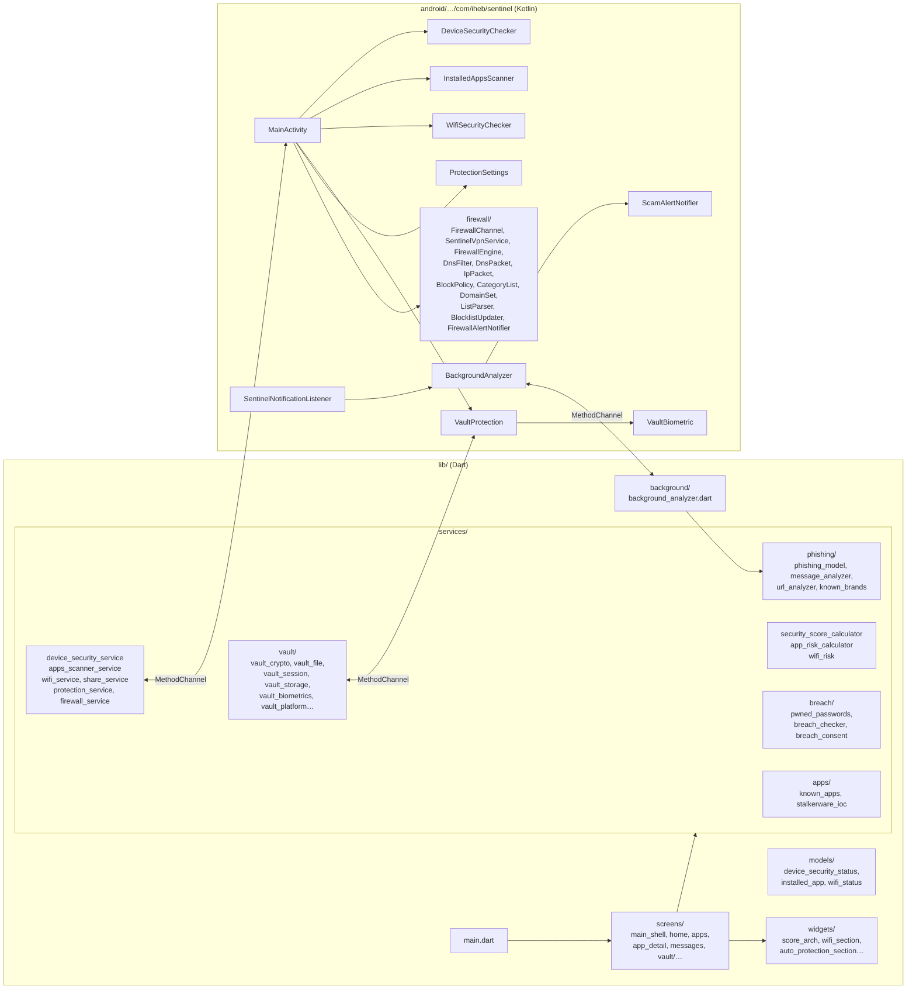
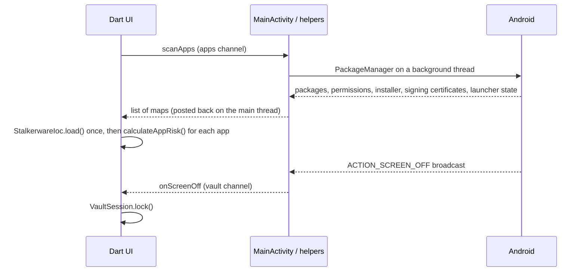
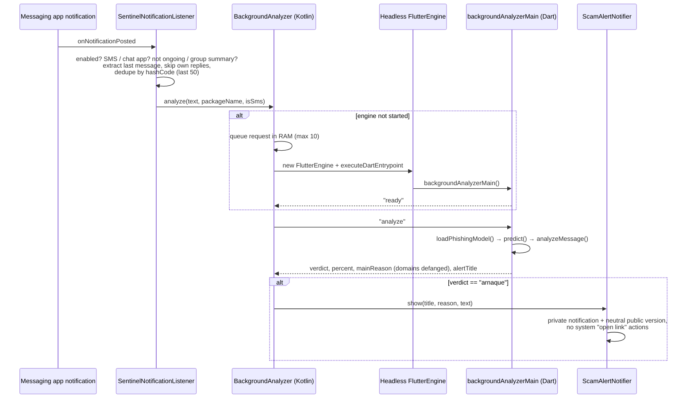
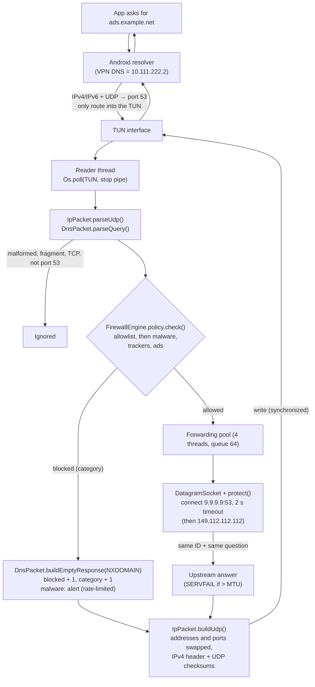
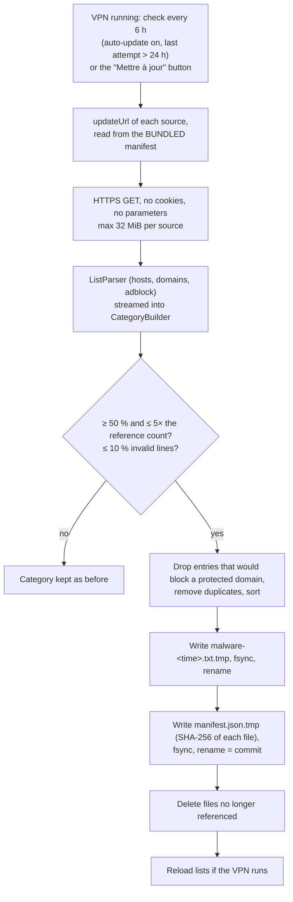
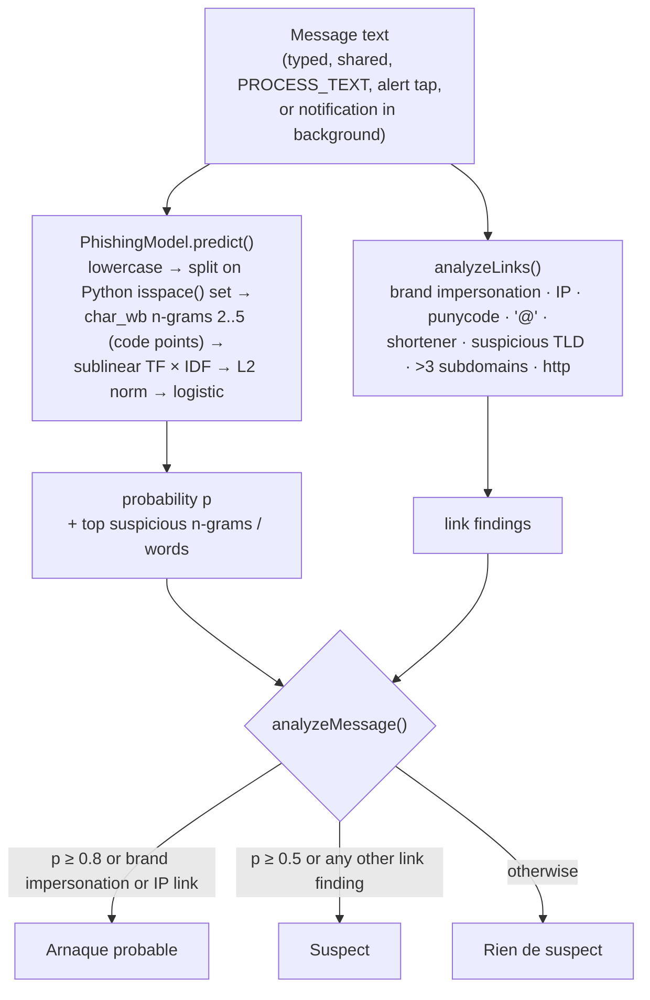
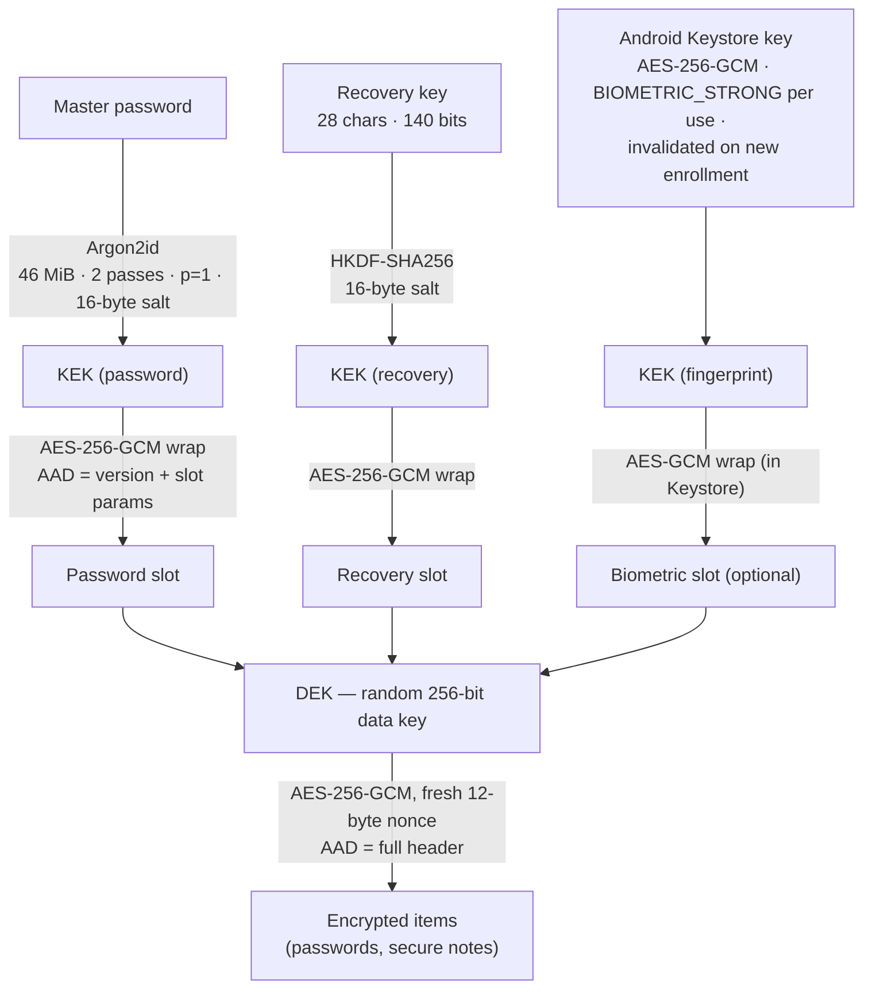

# Architecture

[← Back to README](../README.md) · [Security design](SECURITY_DESIGN.md)

Sentinel is a Flutter app with Android as its only target. Dart contains the UI and all the decision logic (risk rules, ML inference, cryptography). Kotlin reads Android state and talks to the system services that Flutter cannot reach directly. The two sides communicate through named `MethodChannel`s.

Most of the logic is written as **pure functions** (`calculateSecurityScore`, `calculateAppRisk`, `assessWifi`, `analyzeMessage`, `analyzePasswordHealth`…). They take plain data and return a report without calling Android, which makes them easy to unit-test.

## Code layout



The app has four tabs (`main_shell.dart`): **Accueil** (device audit, Wi-Fi and the DNS firewall), **Applications**, **Messages** (message check and the automatic protection switch) and **Coffre** (vault).

## Method channels

| Channel | Kotlin side | Dart → Kotlin | Kotlin → Dart |
|---|---|---|---|
| `com.iheb.sentinel/device_security` | `MainActivity` → `DeviceSecurityChecker` | `getSecurityStatus`, `openSettings` | — |
| `com.iheb.sentinel/apps` | `MainActivity` → `InstalledAppsScanner` (background executor) | `scanApps`, `openAppSettings`, `uninstallApp`, `openWebPage` | — |
| `com.iheb.sentinel/share` | `MainActivity` | `getInitialSharedText` | `onSharedText` |
| `com.iheb.sentinel/protection` | `MainActivity` → `ProtectionSettings` | `getStatus`, `setEnabled`, `openListenerSettings`, `openNotificationSettings`, `requestNotificationPermission` | — |
| `com.iheb.sentinel/wifi` | `WifiSecurityChecker` | `getWifiStatus`, `startListening`, `stopListening`, `openPrivateDnsSettings` | `onWifiChanged` (debounced 400 ms) |
| `com.iheb.sentinel/vault` | `VaultProtection` → `VaultBiometric` | `setSecure`, `copySensitive`, `clearClipboard`, `biometricAvailable`, `biometricEncrypt`, `biometricDecrypt`, `biometricDeleteKey` | `onScreenOff` |
| `com.iheb.sentinel/firewall` | `FirewallChannel` → `SentinelVpnService`, `FirewallEngine` | `prepare`, `start`, `stop`, `status`, `config`, `setCategoryEnabled`, `addAllowed`, `removeAllowed`, `setAutoUpdate`, `updateNow` | — |
| `com.iheb.sentinel/background_analysis` | `BackgroundAnalyzer` (headless engine) | `ready` | `analyze` |



## Headless engine for background analysis

When automatic protection is on, `SentinelNotificationListener` gets message notifications. Kotlin does not re-implement the model. Instead, `BackgroundAnalyzer` starts a **headless `FlutterEngine`** (no UI) on the first message and runs the Dart entry point `backgroundAnalyzerMain` (marked `@pragma('vm:entry-point')` and re-exported from `main.dart` so release builds keep it). The engine stays in `FlutterEngineCache` for later messages and is destroyed when protection is turned off or the listener disconnects.



Only scams trigger an alert. "Suspect" never does, to avoid alert fatigue. Tapping the alert opens the Messages tab with the text, through the same `EXTRA_TEXT` path as the Android share sheet.

## DNS firewall

The DNS firewall (`android/…/firewall/`) is a local `VpnService`. The TUN interface gets private addresses (`10.111.222.1/32`, `fdc5:3a71:9e04::1/128`), a virtual DNS server (`10.111.222.2`, `fdc5:3a71:9e04::2`) and **routes to those two DNS addresses only**. Android then sends every app's system DNS queries into the TUN, while the rest of the traffic keeps using the real network directly.



Every query adds 1 to the "total" counter. The domain name is never logged or stored (see [Security design](SECURITY_DESIGN.md#38-trackers-and-dangerous-domains-dns-firewall)).

Packet layout handled by `IpPacket` and `DnsPacket`:

```text
IPv4 header (20 bytes)          IPv6 header (40 bytes)
  version/IHL, total length       version, payload length
  flags/fragment (DF only)        next header = 17 (UDP), hop limit
  TTL, protocol = 17, checksum    source (16), destination (16)
  source (4), destination (4)
UDP header (8 bytes)
  source port, destination port = 53, length, checksum (pseudo-header + data)
DNS message
  header (12): ID, flags (QR, opcode, RD, RA, RCODE), 4 counts
  question: name as labels (3www7example3com0, or a 0xC0 pointer), type, class
```

Life cycle:

- **prepare.** `VpnService.prepare()` returns an `Intent` the first time: `FirewallChannel` opens Android's consent screen and answers Dart from `MainActivity.onActivityResult`.
- **start.** `startForegroundService` → `startForeground` (type `systemExempted` on Android 14+, the type Android documents for VPN apps) → `establish()` → reader thread.
- **stop.** "Arrêter" in the notification, the switch, `onRevoke` (another VPN) or `onDestroy`. Closing the write end of a pipe wakes `Os.poll`, the reader thread ends, the pool is shut down (each socket times out after 2 s at most), then the TUN is closed.
- **Unit tests.** Everything except `SentinelVpnService`, `FirewallChannel`, `FirewallEngine`, `FirewallSettings` and `FirewallAlertNotifier` is plain Kotlin without Android APIs. JUnit tests in `android/app/src/test` run with `./gradlew testDebugUnitTest` (also in CI). The real `org.json` is added as a test dependency, because Android's copy only exists on a device.

### Blocklists

`tools/blocklists/update_lists.py` builds `assets/blocklists/` from public lists at pinned commits (sources, licenses and attributions: [tools/blocklists/README.md](../tools/blocklists/README.md)):

| File | Category | Default | Entries (19 Oct 2026) |
|---|---|---|---|
| `malware.txt` | Malware et hameçonnage (alerts) | on | 430,961 |
| `trackers.txt` | Traqueurs | on | 119,217 |
| `ads.txt` | Publicités | off (may break some apps) | 31,799 |
| `protected.txt` | Domains that must never be blocked | — | 97 |
| `manifest.json` | Sources, licenses, attributions, date, entry count and SHA-256 of each file | — | — |

**Format.** One entry per line, sorted by byte value, LF endings: `ads.example.com` blocks that exact name, `*.example.com` blocks the name and all its subdomains. Hosts-file sources (`0.0.0.0 name`) and plain lists are exact unless the upstream list is meant to cover subdomains (ShadowWhisperer `Wild_*`, `Malware`, `Scam`); Adblock rules (`||name^`) always cover subdomains. Entries are lowercased, converted to punycode (IDNA 2003 on both sides), stripped of the final dot; IPs, single labels and invalid labels are dropped; duplicates and entries already covered by a `*.` parent are removed. `.gitattributes` marks the files `-text` so Git never converts them to CRLF (that would change their SHA-256).

**Data structure.** Each category is a `CategoryList` = two `DomainSet`s (exact, `*.`). A `DomainSet` is one `ByteArray` holding every name back to back in sorted order, plus an `IntArray` of start offsets; lookup is a binary search comparing bytes in place, with no allocation. A query checks the exact set once, then the `*.` set for the name and each parent (`a.b.c`, `b.c`, `c`). Measured on the real `malware.txt` with `DomainSetTest.benchmark` (JVM 17, 431k entries):

| Structure | Memory per entry | Total for malware | Lookup (name + parents) | Build |
|---|---|---|---|---|
| `HashSet<String>` | 114 bytes (measured) | ~49 MB | 277 ns | 60 ms (lines already in memory) |
| Sorted `ByteArray` + offsets | 32 bytes measured, 30 computed | ~14 MB | 492 ns | 160 ms (read + parse + SHA-256) |

The sorted array uses about 3.5× less memory for a lookup that stays under a microsecond (a forwarded DNS query takes 10–100 ms), which matters in a service that runs all day next to other apps. ART numbers differ from the JVM, but the ratio comes from object headers and table nodes that ART also has. With the default categories (malware + trackers) about 17 MB are used; a disabled category is not loaded at all.

**Loading.** `FirewallEngine` owns one background thread (`sentinel-lists`). When the VPN starts, the reader thread starts at once with an empty policy, and the lists are loaded in the background (about a second): queries pass unfiltered until then (`listsLoading` in the status). For each enabled category the engine reads the private copy from `filesDir/blocklists/` if its manifest is newer than the bundled one and its SHA-256 matches, otherwise the asset (`flutter_assets/assets/blocklists/`). A mismatch or a parse error falls back to the asset; if that fails too, the category is empty. The result is an immutable `BlockPolicy` stored in a `@Volatile` field: changing a category or the allowlist builds a new one and swaps it, without restarting the VPN and without any lock on the DNS path. Stopping the VPN frees the lists.

**Updates** (off by default, explicit consent sheet in the app):



Each category succeeds or fails on its own. New data files get a new name, and the private manifest is replaced last in one rename, so a crash at any point leaves either the old version or the new one, never a mix.

**Alerts.** A block in the "Malware et hameçonnage" category posts "Site dangereux bloqué" (`FirewallAlertNotifier`): domain defanged (`site[.]xyz`), `VISIBILITY_PRIVATE` with a neutral public version, no system-generated actions, tapping only opens the app. `AlertLimiter` allows one alert per domain per hour and 10 per hour in total; the names it remembers live in memory for one hour at most. Trackers and ads never alert.

## Scam detection flow



The model is trained offline in Python (`ml/train.py`) and shipped as `assets/models/phishing_model.json` (8,000-entry vocabulary, IDF, coefficients, intercept, metrics). The Dart implementation follows the specification in [`ml/README.md`](../ml/README.md). `test/phishing_parity_test.dart` checks it against scikit-learn's output on 30 fixtures with a tolerance of 1e-9.

## Vault key hierarchy



`vault.json` (version 2) lives in the app's private support directory:

```text
{
  "version": 2,
  "derniereOuvertureMdp": "<UTC, to the second>",   ┐
  "keySlots": [                                      │ header = AAD of "data"
    { "type": "password", "kdf": {…}, "wrappedKey": {nonce, chiffre} },
    { "type": "recovery", "sel": "…", "wrappedKey": {…} },
    { "type": "biometric", "wrappedKey": {…} }       ┘
  ],
  "data": { "nonce": "…", "chiffre": "…" }
}
```

Key points:

- **One DEK, several ways to unwrap it.** Changing the master password only rewrites the password slot. The items are not re-encrypted with a new key.
- **Recovery.** "Forgot password" opens the vault with the recovery key, then sets a new password *and* a new recovery key. The old recovery key stops working.
- **Fingerprint.** `biometricEncrypt` generates a fresh Keystore key and encrypts the DEK after a `BiometricPrompt` with a `CryptoObject`. If fingerprints change, the key becomes invalid. The biometric slot is then dropped at the next password unlock.
- **7-day rule.** `derniereOuvertureMdp` is inside the authenticated header. Once it is more than 7 days old (or more than one day in the future), the fingerprint is refused and the password is required.
- **Migration.** Version 1 files (a single password, no slots) are still read. They are upgraded to version 2 on the first successful password unlock, reusing the same KEK.
- **Session.** `VaultSession` holds the DEK in memory only while the vault is open. `lock()` overwrites it with zeros. Every change copies the DEK first, so a lock during a write cannot encrypt with a zeroed key.

## Other data stored on the device

| Data | Where | Content |
|---|---|---|
| Vault | `vault.json` in the application support directory | Encrypted (see above) |
| Breach-check consent | `breach_consent.json` in the same directory | `{"accepted": true/false}` |
| Automatic protection switch | `SharedPreferences` `sentinel_protection` | One boolean |
| DNS firewall counters | Memory of `SentinelVpnService` / `FirewallEngine` only | Total, blocked, blocked per category; reset at each start |
| DNS firewall settings | `SharedPreferences` `sentinel_firewall` | Category switches, allowlist (domains the user typed), auto-update switch, dates of the last update and attempt |
| Updated blocklists | `filesDir/blocklists/` | Public lists and their manifest, nothing about the user |
| Recent malware alerts | Memory of `AlertLimiter` only | Blocked domains alerted in the last hour, to rate-limit alerts |
| Fingerprint key | Android Keystore, alias `sentinel_vault_bio` | Non-exportable AES key |

Message text, breach results and scan results are never written to disk. None of the data above is included in Android backups or device-to-device transfers (`allowBackup="false"` and `res/xml/data_extraction_rules.xml`).
