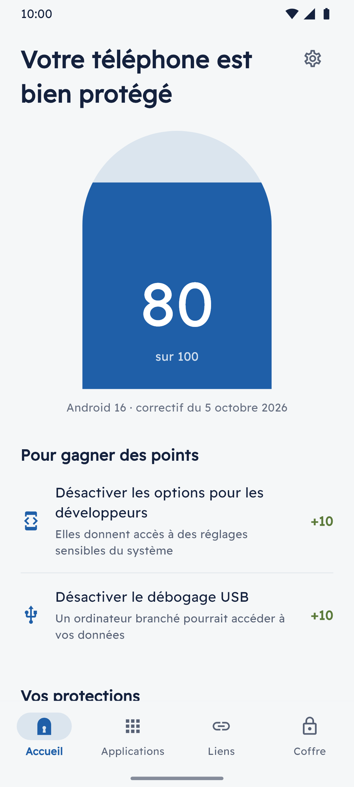
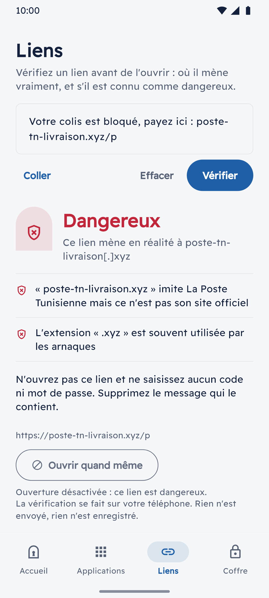

<!--
Page GitHub Release de la version 1.1.0.
- Tag : v1.1.0   - Titre : Sentinel 1.1.0
- Fichier à joindre : build\sentinel-1.1.0.apk (déjà nommé par tools\release\build_release.ps1).
- Avant de publier : remplacer 94e3a65154110249686dbdc79336810c455cb682b828d218435070dd3fcc696f (deux fois) par le SHA-256 affiché par tools\release\build_release.ps1.
Ce commentaire n'apparaît pas sur GitHub : tout le fichier peut être collé tel quel.
-->

**Français** · English version below.

# Sentinel 1.1.0

**Cette version remplace les versions 1.0.0 et 1.0.1.**

**L'application n'est plus bloquée par Google Play Protect.** Sentinel ne déclare plus aucun accès que Play Protect bloque hors du Play Store (lecture des notifications, SMS, accessibilité) : l'APK de cette page s'installe normalement.

Sentinel est une application Android de sécurité qui fonctionne **entièrement sur votre téléphone** : pas de compte, pas de publicité, pas de statistiques d'usage. Elle vérifie la sécurité du téléphone et des applications, vérifie les liens avant que vous les ouvriez, bloque les sites dangereux et garde vos mots de passe dans un coffre chiffré.

Interface en français, arabe et anglais. Android 7.0 ou plus récent.

## Nouveautés de la 1.1.0

- **Nouvel onglet « Liens »** : collez un lien, partagez-le depuis une autre application, sélectionnez-le puis « Vérifier le lien avec Sentinel », ou scannez un QR code. Sentinel affiche **Dangereux**, **Suspect** ou **Aucun problème connu**, vous dit **où le lien mène en réalité** (par exemple `poste-tn-livraison[.]xyz`), pourquoi, et quoi faire.
- Le vérificateur utilise les règles anti-arnaque (fausses banques tunisiennes, faux La Poste, adresses IP, liens raccourcis…) et la liste des sites dangereux du pare-feu, même pare-feu arrêté. Votre liste blanche est respectée.
- **Rien n'est envoyé, rien n'est enregistré**, aucune permission demandée. Un lien raccourci n'est jamais ouvert pour découvrir sa destination. Rien ne s'ouvre tout seul, et « Ouvrir quand même » est désactivé pour un lien dangereux.
- **Protection automatique quand vous cliquez** : activez le pare-feu en un appui depuis l'onglet Liens ; il bloque alors les sites dangereux connus, même ouverts depuis un SMS ou WhatsApp.
- **L'onglet « Messages » est retiré** (analyse des messages, protection automatique des messages reçus, « Signaler ce message ») : le modèle n'avait pas de vraies données tunisiennes, et le copier-coller de messages n'était pas utilisé. Sentinel ne contacte plus aucun serveur de Sentinel.
- **Une seule version** : nom de paquet `com.iheb.sentinel`, fichier `sentinel-1.1.0.apk`.
- **Nouveau design**, même identité (bleu de Sidi Bou, arche du score) : un accueil plus clair (le score, puis ce qu'il reste à faire, puis vos protections), des verdicts lisibles en couleur, icône et texte, de petits dessins originaux pour les écrans vides et des animations douces, coupées si vous avez choisi « Supprimer les animations » dans Android.

 

**Vous aviez installé la 1.0.1 ?** La 1.0.1 (`com.iheb.sentinel.standard`) est une application distincte : la 1.1.0 ne la remplace pas. Si vous utilisiez le coffre, touchez d'abord « Exporter une sauvegarde chiffrée » dans le coffre de la 1.0.1, installez la 1.1.0, choisissez « Restaurer une sauvegarde », puis désinstallez la 1.0.1.

**Vous aviez encore la 1.0.0 ?** La 1.1.0 s'installe par-dessus, comme une mise à jour normale : vos données sont gardées.

## Fonctionnalités

- **Audit du téléphone** : un score sur 100 (verrouillage de l'écran, root, mises à jour de sécurité, options pour les développeurs…) et un lien vers le bon réglage pour corriger.
- **Analyse des applications** : un score de risque expliqué pour chaque app, les fausses applications (imitations de WhatsApp, Facebook…, mods de WhatsApp) et les logiciels espions connus, même déguisés en app système.
- **Accès sensibles** : quelles apps ont utilisé la caméra, le micro ou la localisation, la nuit ou en arrière-plan.
- **Vérificateur de liens** : verdict, vraie destination, raisons et conseil ; partage, sélection de texte ou copier-coller.
- **QR codes** : scanner anti-hameçonnage ; rien ne s'ouvre sans votre confirmation.
- **Pare-feu DNS** : environ 582 000 sites malveillants, traqueurs et publicitaires bloqués, avec une tuile dans les Paramètres rapides.
- **Wi-Fi** : type de chiffrement, portail captif et DNS privé du réseau.
- **Coffre-fort chiffré** : mots de passe, notes, photos et PDF, déverrouillés par mot de passe maître, empreinte ou clé de récupération ; sauvegarde chiffrée pour changer de téléphone.
- **Santé des mots de passe** : mots de passe ayant fuité, réutilisés ou faibles, et générateur.
- **Bilan de la semaine** (avec le nombre de liens vérifiés), thème sombre, accessibilité (TalkBack, grande police).

## Vie privée : ce qui sort du téléphone, et quand

Toutes les vérifications se font sur le téléphone. Les liens et QR codes vérifiés restent en mémoire puis sont oubliés : ils ne sont jamais envoyés. Sentinel ne contacte Internet que pour **trois fonctions facultatives**, jamais au démarrage :

| Quoi | Quand | Ce qui part | Qui le reçoit |
|---|---|---|---|
| Vérification des fuites de mots de passe | Après votre accord, quand vous lancez la vérification | Les **5 premiers caractères** de l'empreinte SHA-1 de chaque mot de passe (jamais le mot de passe) | Have I Been Pwned |
| Pare-feu DNS | Quand vous l'activez | Les noms des sites non bloqués, **chiffrés** (DNS sur TLS ou HTTPS) | Quad9 |
| Mise à jour des listes de blocage | Désactivée par défaut ; quand vous la lancez ou l'activez | Une simple demande de téléchargement, sans information sur vous | GitHub |

Ces services voient votre adresse IP, comme tout site web. La sauvegarde Android est désactivée : rien ne part dans le cloud. Désinstaller Sentinel efface tout ce qu'il a enregistré.

## Installation pas à pas

Sentinel n'est pas (encore) sur le Play Store : on l'installe à partir du fichier APK de cette page.

1. **Sur le téléphone**, ouvrez cette page dans votre navigateur (Chrome par exemple).
2. Descendez jusqu'à **Assets** et touchez **sentinel-1.1.0.apk**. Si le navigateur demande de confirmer le téléchargement, touchez **Télécharger**.
3. Une fois le téléchargement terminé, touchez **Ouvrir** (ou ouvrez le fichier depuis l'application **Fichiers**, dossier *Téléchargements*).
4. Android affiche : *« Pour votre sécurité, votre téléphone n'est pas autorisé à installer des applications inconnues provenant de cette source »*. Touchez **Paramètres**, activez **Autoriser cette source**, puis revenez en arrière.
5. Touchez **Installer**.
6. **Google Play Protect** peut afficher un simple avertissement, par exemple *« Application non reconnue »* ou *« Développeur inconnu »*. **C'est normal** pour une application installée hors du Play Store : touchez **Plus d'informations**, puis **Installer quand même**. Si Play Protect propose d'analyser l'application, vous pouvez accepter.
7. Ouvrez Sentinel : une courte présentation explique chaque fonction.
8. Conseil : retournez dans les réglages du navigateur et **désactivez « Autoriser cette source »**. Vous pourrez la réactiver pour une mise à jour.

**Mises à jour** : il n'y a pas de mise à jour automatique. Pour une nouvelle version, téléchargez le nouvel APK sur la page *Releases* et installez-le par-dessus : vos données sont gardées. Android refuse une mise à jour signée par une autre clé, ce qui vous protège d'un faux APK.

N'installez jamais un APK de Sentinel venant d'un autre site, d'un groupe ou d'une messagerie.

## Vérifier l'APK (facultatif, sur un ordinateur)

**1. L'empreinte du fichier** doit être exactement :

```
94e3a65154110249686dbdc79336810c455cb682b828d218435070dd3fcc696f
```

- Windows (PowerShell) : `Get-FileHash .\sentinel-1.1.0.apk -Algorithm SHA256`
- macOS : `shasum -a 256 sentinel-1.1.0.apk`
- Linux : `sha256sum sentinel-1.1.0.apk`

**2. La signature** (outil `apksigner` du SDK Android, dossier `build-tools`) :

```
apksigner verify --print-certs sentinel-1.1.0.apk
```

La sortie doit contenir `Verifies` et cette empreinte SHA-256 du certificat (la même clé que pour les versions précédentes) :

```
ec541b88160d995808bb24a61a8968d7c3c0311b02d955cc88b92fc7d08a1030
```

Toute autre empreinte (par exemple `CN=Android Debug`) veut dire que l'APK n'est pas officiel : ne l'installez pas.

## Limites connues

- **Vérificateur de liens** : « Aucun problème connu » ne garantit pas qu'un site est sûr. Les listes ne connaissent pas les sites d'arnaque tout neufs, et un lien raccourci n'est pas suivi (sa vraie destination reste inconnue).
- **Plus d'analyse des messages** : Sentinel ne lit plus le texte des messages ; il ne vérifie que les liens.
- **Android 7, 8 et 9** : un mot de passe copié depuis le coffre peut être lu par les autres applications (Sentinel prévient avant la copie et l'efface après 10 s) ; le DNS sur HTTPS n'est pas disponible (le DNS sur TLS l'est) ; « Accès sensibles » montre moins de détails.
- **Pare-feu DNS** : les applications qui utilisent leur propre DNS chiffré le contournent. Quad9 voit les noms des sites non bloqués.
- **Logiciels espions** : la liste n'est pas exhaustive ; aucune alerte ne veut pas dire aucun logiciel espion. La comparaison avec les certificats des applications officielles n'est pas encore remplie.
- **Téléphone rooté** : un attaquant avec le root peut lire la mémoire des applications. Le coffre reste protégé par votre mot de passe maître.
- Projet personnel, maintenu par une seule personne.

## Sécurité

- L'application a été auditée selon **OWASP MASVS v2** (analyse statique et dynamique). Deux constats (SEN-06, SEN-12) concernaient du code retiré dans la 1.1.0. [Rapport d'audit](https://github.com/Ihebnsir/sentinel/blob/v1.1.0/docs/audit/RAPPORT_AUDIT.md).
- Pour signaler une faille, **sans issue publique** : [SECURITY.md](https://github.com/Ihebnsir/sentinel/blob/v1.1.0/SECURITY.md).
- Détail des changements : [CHANGELOG.md](https://github.com/Ihebnsir/sentinel/blob/v1.1.0/CHANGELOG.md).

---

## English

# Sentinel 1.1.0

**This version replaces versions 1.0.0 and 1.0.1.**

**The app is no longer blocked by Google Play Protect.** Sentinel no longer declares any access that Play Protect blocks outside the Play Store (notification reading, SMS, accessibility): the APK on this page installs normally.

Sentinel is an Android security app that runs **entirely on your phone**: no account, no ads, no usage analytics. It checks the security of your phone and apps, checks links before you open them, blocks dangerous sites and keeps your passwords in an encrypted vault.

Interface in French, Arabic and English. Android 7.0 or newer.

## What's new in 1.1.0

- **New "Links" tab**: paste a link, share it from another app, select it and tap "Check link with Sentinel", or scan a QR code. Sentinel shows **Dangerous**, **Suspicious** or **No known problem**, tells you **where the link really leads** (for example `poste-tn-livraison[.]xyz`), why, and what to do.
- The checker uses the anti-scam rules (fake Tunisian banks, fake La Poste, IP addresses, shortened links…) and the firewall's list of dangerous sites, even when the firewall is off. Your allowlist is respected.
- **Nothing is sent, nothing is saved**, no permission is requested. A shortened link is never opened to find out where it goes. Nothing opens automatically, and "Open anyway" is disabled for a dangerous link.
- **Automatic protection when you tap a link**: turn on the firewall in one tap from the Links tab; it then blocks known dangerous sites, even when opened from an SMS or WhatsApp.
- **The "Messages" tab is removed** (message analysis, automatic protection of incoming messages, "Report this message"): the model had no real Tunisian data, and copy-pasting messages was not used. Sentinel no longer contacts any Sentinel server.
- **A single version**: package name `com.iheb.sentinel`, file `sentinel-1.1.0.apk`.
- **New design**, same identity (Sidi Bou blue, score arch): a clearer home screen (the score, then what is left to do, then your protections), verdicts shown with color, icon and text, small original drawings for empty screens and gentle animations, turned off if you chose "Remove animations" in Android.

 

**Did you install 1.0.1?** 1.0.1 (`com.iheb.sentinel.standard`) is a separate app: 1.1.0 does not replace it. If you used the vault, first tap "Export an encrypted backup" in the 1.0.1 vault, install 1.1.0, choose "Restore a backup", then uninstall 1.0.1.

**Still on 1.0.0?** 1.1.0 installs over it as a normal update: your data is kept.

## Features

- **Device audit**: a score out of 100 (screen lock, root, security updates, developer options…) with a link to the right setting to fix each issue.
- **App scanner**: an explained risk score for each app, fake apps (WhatsApp or Facebook look-alikes, WhatsApp mods) and known stalkerware, even when disguised as a system app.
- **Sensitive access**: which apps used the camera, microphone or location, at night or in the background.
- **Link checker**: verdict, real destination, reasons and advice; share, text selection or copy-paste.
- **QR codes**: anti-phishing scanner; nothing opens without your confirmation.
- **DNS firewall**: about 582,000 malware, tracker and ad domains blocked, with a Quick Settings tile.
- **Wi-Fi**: the network's encryption type, captive portal and Private DNS.
- **Encrypted vault**: passwords, notes, photos and PDFs, unlocked with a master password, fingerprint or recovery key; encrypted backup to move to a new phone.
- **Password health**: breached, reused or weak passwords, and a generator.
- **Weekly summary** (with the number of links checked), dark theme, accessibility (TalkBack, large fonts).

## Privacy: what leaves the phone, and when

All checks happen on the phone. Checked links and QR codes stay in memory, then are forgotten: they are never sent. Sentinel only goes online for **three optional features**, never at startup:

| What | When | What is sent | Who receives it |
|---|---|---|---|
| Password breach check | After your consent, when you start the check | The **first 5 characters** of each password's SHA-1 hash (never the password) | Have I Been Pwned |
| DNS firewall | When you turn it on | The names of non-blocked sites, **encrypted** (DNS over TLS or HTTPS) | Quad9 |
| Blocklist updates | Off by default; when you start or enable them | A plain download request, with no information about you | GitHub |

Like any website, these services see your IP address. Android backup is disabled: nothing goes to the cloud. Uninstalling Sentinel erases everything it stored.

## Step-by-step installation

Sentinel is not on the Play Store (yet): you install it from the APK file on this page.

1. **On your phone**, open this page in your browser (Chrome, for example).
2. Scroll down to **Assets** and tap **sentinel-1.1.0.apk**. If the browser asks you to confirm the download, tap **Download**.
3. When the download is finished, tap **Open** (or open the file from the **Files** app, *Downloads* folder).
4. Android says: *"For your security, your phone currently isn't allowed to install unknown apps from this source"*. Tap **Settings**, turn on **Allow from this source**, then go back.
5. Tap **Install**.
6. **Google Play Protect** may show a simple warning, such as *"Unrecognized app"* or *"Unknown developer"*. **This is normal** for an app installed outside the Play Store: tap **More details**, then **Install anyway**. If Play Protect offers to scan the app, you can accept.
7. Open Sentinel: a short introduction explains each feature.
8. Tip: go back to the browser's settings and **turn off "Allow from this source"**. You can turn it on again for an update.

**Updates**: there are no automatic updates. For a new version, download the new APK from the *Releases* page and install it over the old one: your data is kept. Android refuses an update signed with a different key, which protects you from a fake APK.

Never install a Sentinel APK from another website, a group or a messaging app.

## Verify the APK (optional, on a computer)

**1. The file's fingerprint** must be exactly:

```
94e3a65154110249686dbdc79336810c455cb682b828d218435070dd3fcc696f
```

- Windows (PowerShell): `Get-FileHash .\sentinel-1.1.0.apk -Algorithm SHA256`
- macOS: `shasum -a 256 sentinel-1.1.0.apk`
- Linux: `sha256sum sentinel-1.1.0.apk`

**2. The signature** (`apksigner`, from the Android SDK `build-tools` folder):

```
apksigner verify --print-certs sentinel-1.1.0.apk
```

The output must contain `Verifies` and this certificate SHA-256 digest (the same key as previous versions):

```
ec541b88160d995808bb24a61a8968d7c3c0311b02d955cc88b92fc7d08a1030
```

Any other fingerprint (for example `CN=Android Debug`) means the APK is not official: do not install it.

## Known limitations

- **Link checker**: "No known problem" does not guarantee a site is safe. The lists don't know brand-new scam sites, and a shortened link is not followed (its real destination stays unknown).
- **No more message analysis**: Sentinel no longer reads message text; it only checks links.
- **Android 7, 8 and 9**: a password copied from the vault can be read by other apps (Sentinel warns before copying and clears it after 10 s); DNS over HTTPS is not available (DNS over TLS is); "Sensitive access" shows fewer details.
- **DNS firewall**: apps that use their own encrypted DNS bypass it. Quad9 sees the names of non-blocked sites.
- **Stalkerware**: the list is not exhaustive; no alert does not mean no stalkerware. Comparison with the certificates of official apps is not filled in yet.
- **Rooted phone**: an attacker with root can read app memory. The vault stays protected by your master password.
- Personal project, maintained by one person.

## Security

- The app was audited against **OWASP MASVS v2** (static and dynamic analysis). Two findings (SEN-06, SEN-12) concerned code removed in 1.1.0. [Audit report](https://github.com/Ihebnsir/sentinel/blob/v1.1.0/docs/audit/RAPPORT_AUDIT.md) (in French).
- To report a vulnerability, **without a public issue**: [SECURITY.md](https://github.com/Ihebnsir/sentinel/blob/v1.1.0/SECURITY.md).
- Full list of changes: [CHANGELOG.md](https://github.com/Ihebnsir/sentinel/blob/v1.1.0/CHANGELOG.md) (in French).
