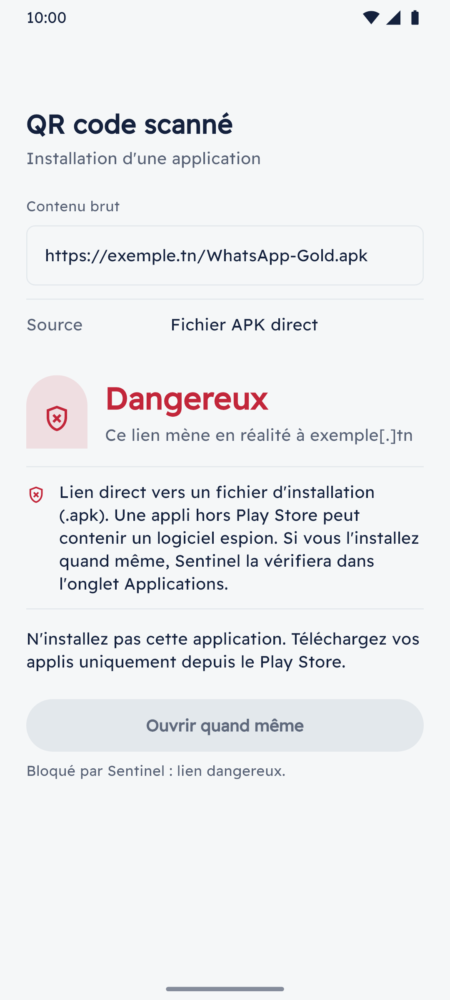
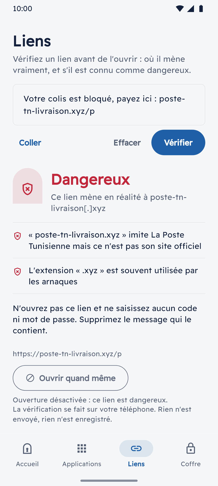

<!--
Page GitHub Release de la version 1.2.0.
- Tag : v1.2.0   - Titre : Sentinel 1.2.0
- Fichier à joindre : build\sentinel-1.2.0.apk (déjà nommé par tools\release\build_release.ps1).
- Avant de publier : remplacer À_REMPLIR (deux fois, une en français, une en anglais) par le SHA-256 affiché par tools\release\build_release.ps1.
Ce commentaire n'apparaît pas sur GitHub : tout le fichier peut être collé tel quel.
-->

**Français** · English version below.

# Sentinel 1.2.0

**Cette version remplace les versions précédentes** (1.0.0, 1.0.1 et 1.1.0). Elle s'installe par-dessus la 1.1.0 : vos données sont gardées.

Sentinel est une application Android de sécurité qui fonctionne **entièrement sur votre téléphone** : pas de compte, pas de publicité, pas de statistiques d'usage. Interface en français, arabe et anglais. Android 7.0 ou plus récent.

## Nouveautés : un scanner de QR code bien plus complet

- **QR code depuis une image** : touchez « Depuis une image » dans l'onglet Liens, ou **partagez une image vers Sentinel** (un QR code reçu sur WhatsApp, une capture d'écran). Aucune permission demandée ; l'image est lue sur le téléphone, jamais copiée ni gardée. Plusieurs QR codes dans l'image : Sentinel les liste.
- **Liens WhatsApp, Telegram, Messenger, Viber** : Sentinel montre l'application, le numéro avec son indicatif (alerte si le pays est inattendu), le groupe, et le message pré-rempli. Alerte si ce message demande un code, un mot de passe ou de l'argent, en français, arabe, derja ou anglais.
- **Installations d'applications** : pour un lien Play Store, l'identifiant de l'application est comparé aux vraies applications (WhatsApp, Facebook…) pour repérer les imitations. Un lien direct vers un fichier `.apk` est marqué **Dangereux**.
- **Autres formats** : fiche contact qui se fait passer pour une banque ou un « service client », e-mail, position sur une carte, adresse de cryptomonnaie (n'envoyez jamais d'argent à une adresse reçue d'un inconnu), rendez-vous de calendrier.
- **Conseil anti-arnaque** discret après chaque scan à la caméra (QR collé sur un parking ou une affiche…).
- **Partager mon Wi-Fi** : saisissez le nom du réseau et le mot de passe, Sentinel affiche un QR code pour vos invités. Captures d'écran bloquées, rien n'est enregistré.

 

Toujours aucune permission sensible : l'APK n'est pas bloqué par Google Play Protect.

## Installation

1. **Sur le téléphone**, ouvrez cette page, descendez jusqu'à **Assets** et touchez **sentinel-1.2.0.apk**.
2. Ouvrez le fichier téléchargé. Si Android le demande, autorisez l'installation depuis cette source, puis touchez **Installer**.
3. Play Protect peut afficher « Application non reconnue » : c'est normal hors du Play Store. Touchez **Plus d'informations**, puis **Installer quand même**.
4. Conseil : désactivez ensuite « Autoriser cette source » dans les réglages du navigateur.

Pas de mise à jour automatique : pour une nouvelle version, installez le nouvel APK par-dessus. N'installez jamais un APK de Sentinel venant d'un autre site ou d'une messagerie.

## Vérifier l'APK (facultatif, sur un ordinateur)

**1. L'empreinte du fichier** doit être exactement :

```
À_REMPLIR
```

- Windows (PowerShell) : `Get-FileHash .\sentinel-1.2.0.apk -Algorithm SHA256`
- macOS : `shasum -a 256 sentinel-1.2.0.apk`
- Linux : `sha256sum sentinel-1.2.0.apk`

**2. La signature** (outil `apksigner` du SDK Android) :

```
apksigner verify --print-certs sentinel-1.2.0.apk
```

La sortie doit contenir `Verifies` et cette empreinte SHA-256 du certificat (la même clé que pour les versions précédentes) :

```
ec541b88160d995808bb24a61a8968d7c3c0311b02d955cc88b92fc7d08a1030
```

Toute autre empreinte veut dire que l'APK n'est pas officiel : ne l'installez pas.

## Limites connues

- Un QR code flou, minuscule ou coupé dans une photo peut ne pas être trouvé.
- Les listes de mots d'arnaque et d'indicatifs sont des repères, pas une garantie : « Aucun problème connu » ne veut pas dire « sûr ».
- Une vraie fiche de conseiller bancaire est aussi signalée « Suspect » : vérifiez toujours le numéro sur le site officiel.

## Liens

[Changements détaillés](https://github.com/Ihebnsir/sentinel/blob/v1.2.0/CHANGELOG.md) · [Rapport d'audit](https://github.com/Ihebnsir/sentinel/blob/v1.2.0/docs/audit/RAPPORT_AUDIT.md) · [Signaler une faille](https://github.com/Ihebnsir/sentinel/blob/v1.2.0/SECURITY.md)

---

## English

# Sentinel 1.2.0

**This version replaces all previous versions** (1.0.0, 1.0.1 and 1.1.0). It installs over 1.1.0 and keeps your data.

Sentinel is an Android security app that runs **entirely on your phone**: no account, no ads, no usage analytics. Interface in French, Arabic and English. Android 7.0 or later.

## What's new: a much more complete QR code scanner

- **QR code from an image**: tap "From an image" in the Links tab, or **share an image to Sentinel** (a QR code received on WhatsApp, a screenshot). No permission requested; the image is read on the phone, never copied or kept. Several QR codes in the image are listed.
- **WhatsApp, Telegram, Messenger and Viber links**: Sentinel shows the app, the number with its country code (warning for an unexpected country), the group, and the pre-filled message. Warning when that message asks for a code, a password or money, in French, Arabic, Derja or English.
- **App installs**: for a Play Store link, the app's package name is compared with the real apps (WhatsApp, Facebook…) to catch look-alikes. A direct link to an `.apk` file is marked **Dangerous**.
- **Other formats**: a contact card that pretends to be a bank or a "customer service", e-mail, map location, cryptocurrency address (never send money to an address from a stranger), calendar event.
- **A short anti-scam tip** after each camera scan (a QR code stuck on a parking meter or a poster…).
- **Share my Wi-Fi**: type the network name and password, Sentinel shows a QR code for your guests. Screenshots blocked, nothing saved.

 

Still no sensitive permission: the APK is not blocked by Google Play Protect.

## Install

1. **On the phone**, open this page, scroll down to **Assets** and tap **sentinel-1.2.0.apk**.
2. Open the downloaded file. If Android asks, allow installs from this source, then tap **Install**.
3. Play Protect may show "Unrecognized app": this is normal outside the Play Store. Tap **More details**, then **Install anyway**.
4. Tip: turn "Allow from this source" off again in the browser settings.

There are no automatic updates: install a new APK over the old one. Never install a Sentinel APK from another website or a messaging app.

## Verify the APK (optional, on a computer)

**1. The file's fingerprint** must be exactly:

```
À_REMPLIR
```

- Windows (PowerShell): `Get-FileHash .\sentinel-1.2.0.apk -Algorithm SHA256`
- macOS: `shasum -a 256 sentinel-1.2.0.apk`
- Linux: `sha256sum sentinel-1.2.0.apk`

**2. The signature** (`apksigner` from the Android SDK):

```
apksigner verify --print-certs sentinel-1.2.0.apk
```

The output must contain `Verifies` and this certificate SHA-256 digest (same key as previous versions):

```
ec541b88160d995808bb24a61a8968d7c3c0311b02d955cc88b92fc7d08a1030
```

Any other fingerprint means the APK is not official: do not install it.

## Known limitations

- A blurry, tiny or cut QR code in a photo may not be found.
- The scam-word and country-code lists are hints, not a guarantee: "No known problem" does not mean "safe".
- A genuine bank adviser's contact card is also flagged "Suspicious": always check the number on the official website.

## Links

[Full changelog](https://github.com/Ihebnsir/sentinel/blob/v1.2.0/CHANGELOG.md) · [Security audit](https://github.com/Ihebnsir/sentinel/blob/v1.2.0/docs/audit/RAPPORT_AUDIT.md) · [Report a vulnerability](https://github.com/Ihebnsir/sentinel/blob/v1.2.0/SECURITY.md)
